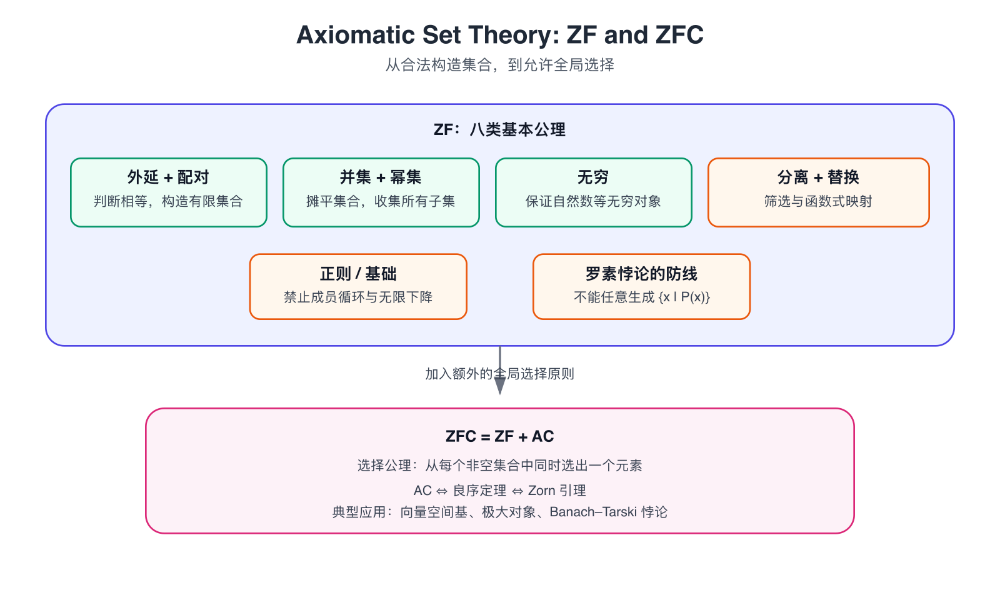

集合论的核心问题并不是“如何计算集合”，而是：**哪些对象可以被承认为集合，以及哪些集合构造是合法的？** 朴素集合论允许我们按照任意性质收集对象，最终会导致罗素悖论；公理化集合论则用一组构造规则限制“集合”的生成方式。

本文采用一种常见的八类公理划分，介绍 ZF（Zermelo–Fraenkel）集合论的基本框架，并在最后加入选择公理得到 ZFC。

{ width="800" }

## 1 ZF 的八类公理

下面的八类公理包括一阶逻辑公式中的两个**公理模式**：分离公理模式和替换公理模式。所谓公理模式，是指对每一个满足语法要求的公式，都有一条对应的公理，因此它们实际上代表无穷多条公理。

### 1.1 外延公理：集合由元素决定

外延公理断言：两个集合相等，当且仅当它们拥有完全相同的元素。

!!! abstract "外延公理（Extensionality）"
    $$
    \forall A\forall B\left[\left(\forall x\,(x\in A\leftrightarrow x\in B)\right)\rightarrow A=B\right]
    $$

结合等号的替换性质，可以简写为

$$
A=B\iff \forall x\,(x\in A\leftrightarrow x\in B).
$$

因此集合中的元素没有顺序，也没有重复次数。例如

$$
\{1,2,3\}=\{3,2,1\}.
$$

外延公理表达了集合论最基本的身份原则：集合不是由表示方法决定的，而是由成员关系决定的。

### 1.2 配对公理：构造有限集合

配对公理保证任意两个集合都可以被放进一个新集合中。

!!! abstract "配对公理（Pairing）"
    $$
    \forall a\forall b\exists C\,\forall x\left[x\in C\leftrightarrow (x=a\lor x=b)\right]
    $$

这个集合记作

$$
C=\{a,b\}.
$$

令 $a=b$，就得到单元素集合 $\{a\}$。例如，先取

$$
a=\varnothing,\qquad b=\{\varnothing\},
$$

便可以构造

$$
\left\{\varnothing,\{\varnothing\}\right\}.
$$

### 1.3 并集公理：把集合摊平一层

并集公理允许把一个集合中各个集合的元素收集起来，去掉中间的一层括号。

!!! abstract "并集公理（Union）"
    $$
    \forall A\exists U\,\forall x\left[x\in U\leftrightarrow \exists B\,(B\in A\land x\in B)\right]
    $$

这个集合记作 $U=\bigcup A$。例如

$$
A=\left\{\{1,2\},\{2,3\}\right\}
$$

时，有

$$
\bigcup A=\{1,2,3\}.
$$

因此，并集运算可以直观地表示为

$$
\left\{\{1,2\},\{2,3\}\right\}\longmapsto \{1,2,3\}.
$$

### 1.4 幂集公理：收集所有子集

幂集公理保证给定集合的所有子集可以组成一个集合。

!!! abstract "幂集公理（Power Set）"
    $$
    \forall A\exists P\,\forall x\left[x\in P\leftrightarrow x\subseteq A\right]
    $$

这个集合记作 $P=\mathcal P(A)$。例如

$$
A=\{1,2\}
$$

时，

$$
\mathcal P(A)=\left\{\varnothing,\{1\},\{2\},\{1,2\}\right\}.
$$

有限集合满足

$$
|A|=n\quad\Longrightarrow\quad |\mathcal P(A)|=2^n.
$$

幂集公理使集合论能够不断产生更大的集合，也是康托尔定理和不可数性理论的重要基础。

### 1.5 无穷公理：保证无穷集合存在

无穷公理并不是直接把自然数集合 $\mathbb N$ 当作一个原始对象，而是保证存在一个集合，其中包含空集，并且对后继运算封闭。

!!! abstract "无穷公理（Infinity）"
    $$
    \exists A\left[\varnothing\in A\land \forall x\left(x\in A\rightarrow x\cup\{x\}\in A\right)\right]
    $$

定义后继运算

$$
S(x)=x\cup\{x\}.
$$

以

$$
0=\varnothing
$$

为起点，可以得到 von Neumann 自然数：

$$
1=S(0)=\{0\}=\{\varnothing\},
$$

$$
2=S(1)=\{0,1\}=\left\{\varnothing,\{\varnothing\}\right\},
$$

$$
3=S(2)=\{0,1,2\}.
$$

继续进行下去，可以在集合论内部构造自然数集合 $\omega$。需要注意的是，无穷公理只保证存在某个满足条件的归纳集合；最小的归纳集合 $\omega$ 还需要通过分离公理从中筛选出来。

### 1.6 分离公理模式：只能从已有集合中筛选

分离公理模式规定：给定一个已经存在的集合 $A$，可以按照公式 $\varphi(x)$ 从中筛选出满足条件的元素。

!!! abstract "分离公理模式（Separation）"
    对任意公式 $\varphi(x)$，都有

    $$
    \forall A\exists B\,\forall x\left[x\in B\leftrightarrow (x\in A\land \varphi(x))\right].
    $$

    因而可以写成

    $$
    B=\{x\in A\mid \varphi(x)\}.
    $$

这条公理允许的形式是

$$
\{x\in A\mid P(x)\},
$$

而不是无限制的

$$
\{x\mid P(x)\}.
$$

这正是现代集合论避开罗素悖论的关键。若允许任意性质都定义一个集合，就可以写出

$$
R=\{x\mid x\notin x\},
$$

然后询问 $R\in R$ 是否成立，立刻得到矛盾。分离公理要求先给出一个已有集合 $A$，所以只能构造

$$
R_A=\{x\in A\mid x\notin x\},
$$

而不能直接构造“所有不属于自身的集合”组成的全集。

!!! warning "分离公理不是任意集合构造原则"
    看到一个性质 $P(x)$ 时，不能自动断言 $\{x\mid P(x)\}$ 是集合。必须先指定一个已存在的背景集合 $A$，再使用 $\{x\in A\mid P(x)\}$ 进行筛选。

### 1.7 替换公理模式：对集合做整体映射

替换公理模式处理这样一种情况：集合 $A$ 中的每个元素都通过某个规则唯一对应到一个对象，那么这些输出组成的值域仍然是一个集合。

!!! abstract "替换公理模式（Replacement）"
    若公式 $\varphi(x,y)$ 对每个 $x\in A$ 唯一确定一个 $y$，即

    $$
    \forall x\in A\;\exists!y\,\varphi(x,y),
    $$

    则存在集合 $B$，满足

    $$
    \forall y\left[y\in B\leftrightarrow \exists x\in A\,\varphi(x,y)\right].
    $$

直观地说，如果

$$
A=\{1,2,3\},\qquad F(x)=x^2,
$$

那么替换公理保证

$$
F[A]=\{F(x)\mid x\in A\}=\{1,4,9\}
$$

是一个集合。

在有限集合上，这似乎只是常识；但对超限递归和序数构造而言，替换公理保证每一步产生的对象仍能被收集成集合，因此它是构造大型无限对象的重要工具。

### 1.8 正则公理：禁止成员关系的无限下降

正则公理又称基础公理。它说，每个非空集合都包含一个与自身没有交集的元素。

!!! abstract "正则公理 / 基础公理（Foundation）"
    $$
    \forall A\left[A\neq\varnothing\rightarrow \exists x\left(x\in A\land x\cap A=\varnothing\right)\right]
    $$

它排除了无限向下的成员链

$$
\cdots\in x_3\in x_2\in x_1,
$$

也排除了成员循环。例如，如果 $x\in x$，令 $A=\{x\}$，则 $x\cap A=\{x\}\neq\varnothing$，与正则公理矛盾。同理，正则公理也排除

$$
x\in y,\qquad y\in x.
$$

因此，集合可以被直观地看成由下向上分层构造：先有 $\varnothing$，再有包含它的集合，再有包含这些集合的集合。

## 2 空集公理与“八条”计数

有些教材会把空集公理单独列出：

!!! abstract "空集公理（Empty Set）"
    $$
    \exists A\,\forall x\,(x\notin A).
    $$

它保证存在没有任何元素的集合，记作 $\varnothing$。由于外延公理保证空集唯一，所以“存在一个空集”就足够定义这个符号。

然而，在包含无穷公理和分离公理模式的体系中，空集公理可以被推出。无穷公理给出一个集合 $A$，然后使用分离公理取

$$
B=\{x\in A\mid x\neq x\}.
$$

因为没有对象满足 $x\neq x$，所以 $B$ 没有元素，即 $B=\varnothing$。

因此，常见的两种计数方式是：

| 计数方式 | 单独列出的内容 |
| --- | --- |
| 八类公理 | 外延、配对、并集、幂集、无穷、分离模式、替换模式、正则 |
| 九类公理 | 在上述八类之外，单独加入空集公理 |

这不是两个互相矛盾的集合论体系，而是公理表述方式不同。更准确地说，应当说明自己采用的是哪一套公理化方案。

## 3 ZF 的整体作用

可以把八类公理的职责概括为：

| 公理 | 它允许的基本操作 |
| --- | --- |
| 外延 | 判断两个集合何时相等 |
| 配对 | 构造 $\{a,b\}$ 和单元素集合 |
| 并集 | 把集合摊平一层 |
| 幂集 | 收集一个集合的所有子集 |
| 无穷 | 保证至少存在无穷集合 |
| 分离 | 从已有集合中按性质筛选 |
| 替换 | 对集合施加定义良好的整体映射 |
| 正则 | 排除成员关系的循环和无限下降 |

从构造角度看，分离公理和替换公理尤其值得区分：

- 分离是“**从一个已有集合中挑出一部分**”；
- 替换是“**把一个已有集合的元素逐个映射到新的对象**”。

二者都不是无限制的“凭性质造集合”，而是在已有集合的范围内进行受控构造。

## 4 选择公理：同时从一族非空集合中选取元素

ZF 的八类公理并不包含选择公理。把选择公理加入 ZF，就得到 ZFC：

$$
\mathrm{ZF}+\mathrm{AC}=\mathrm{ZFC}.
$$

### 4.1 选择公理的表述

设 $\mathcal A$ 是一族非空集合，即

$$
\forall A\in\mathcal A,\quad A\neq\varnothing.
$$

选择公理断言存在一个函数 $f$，使得它从每个集合 $A\in\mathcal A$ 中选出一个元素：

!!! abstract "选择公理（Axiom of Choice, AC）"
    $$
    \forall\mathcal A\left[\left(\forall A\in\mathcal A\;A\neq\varnothing\right)\rightarrow \exists f\,\forall A\in\mathcal A\;(f(A)\in A)\right].
    $$

这里的 $f$ 称为选择函数。更严格地说，在纯集合论中函数本身也被定义为有序对的集合；上式是对选择函数行为的简写。

例如

$$
A_1=\{a,b\},\qquad A_2=\{1,2,3\},\qquad A_3=\{x,y\}
$$

时，可以定义

$$
f(1)=a,\qquad f(2)=2,\qquad f(3)=y.
$$

有限多个集合的选择通常可以逐个完成；选择公理真正发挥作用的地方，是集合族无限、且没有明显的统一选择规则时。它断言：即使没有给出具体的“怎么选”，这样的全局选择函数仍然存在。

### 4.2 选择集

对一族两两不相交的非空集合 $\mathcal A$，选择公理也可以表述为：存在一个集合 $C$，使得每个 $A\in\mathcal A$ 恰好贡献一个元素：

$$
\forall A\in\mathcal A,\qquad |C\cap A|=1.
$$

这样的 $C$ 称为选择集。它与选择函数的关系是：选择函数记录“从哪个集合选出哪个元素”，选择集只收集所有被选出的元素。

## 5 选择公理的独立性与等价形式

### 5.1 相对于 ZF 的独立性

选择公理不是 ZF 其他公理可以证明出来的定理。其经典结论是相对于 ZF 的独立性：在适当的一致性假设下，ZF 与 ZF+AC 都可以保持一致，ZF 与 ZF+$\neg$AC 也可以保持一致。

因此通常写成

$$
\mathrm{ZF}\not\vdash\mathrm{AC},
$$

并说 AC 相对于 ZF 是独立的。这里的“独立”不是说 AC 没有数学意义，而是说：仅凭 ZF 的其余公理，既不能强制接受 AC，也不能强制否定 AC。

### 5.2 良序定理与 Zorn 引理

在 ZF 中，下面三个命题彼此等价：

$$
\boxed{\text{选择公理}}
\Longleftrightarrow
\boxed{\text{良序定理}}
\Longleftrightarrow
\boxed{\text{Zorn 引理}}.
$$

它们强调的是同一个选择原则的不同侧面：

- **选择公理**：从每个非空集合中同时选出一个元素；
- **良序定理**：每个集合都可以赋予一个良序；
- **Zorn 引理**：若偏序集中的每条链都有上界，则偏序集中存在极大元。

在代数中，Zorn 引理尤其常用。例如，为了证明每个向量空间都有一组基，通常考虑所有线性无关集组成的偏序集，再用 Zorn 引理得到极大的线性无关集；这个极大性最终保证它实际上是基。

## 6 选择公理的典型后果

选择公理的力量常常体现在“存在性结论”上，而不是提供一个可执行的选择算法。

### 6.1 每个向量空间都有一组基

对有限维向量空间，基可以通过有限步骤构造；对任意维数的向量空间，结论

$$
\boxed{\text{每个向量空间都有一组基}}
$$

通常借助 Zorn 引理证明，因此其一般形式依赖选择原则。

### 6.2 Banach–Tarski 悖论

在选择公理的帮助下，可以把三维实心球分解成有限个非常不规则的子集，再通过刚体运动重新拼成两个与原球等大的球。这就是 Banach–Tarski 悖论。

它不违反通常的体积守恒，因为分解出来的碎片不是 Lebesgue 可测集，因而不能给每块碎片赋予通常意义下的体积。这个例子说明，选择公理能够推出强大的存在性结论，也可能带来与几何直觉相冲突的对象。

## 7 易错点与复习重点

!!! warning "易错点 1：ZF 与 ZFC 不要混写"
    ZF 不包含选择公理；加入 AC 后才得到 ZFC。说“集合论公理”时，应先说明采用 ZF 还是 ZFC。

!!! warning "易错点 2：分离不是无限制概括"
    分离公理只能构造 $\{x\in A\mid P(x)\}$，不能直接构造 $\{x\mid P(x)\}$。它限制了罗素悖论的发生。

!!! warning "易错点 3：替换要求唯一性"
    替换公理描述的是一个定义良好的函数式映射。对每个 $x\in A$，必须存在唯一的输出 $y$；如果一个输入对应多个输出，就不能直接使用替换公理。

!!! warning "易错点 4：无穷公理不直接给出 $\omega$"
    无穷公理先保证存在一个归纳集合，再通过其他构造得到最小的归纳集合 $\omega$。它也不把自然数作为集合论之外的原始对象。

!!! summary "一句话总结"
    ZF 用一组受控的构造规则定义“哪些集合可以存在”；分离公理防止任意性质生成集合，替换公理保证函数映射的值域仍是集合；选择公理则额外断言，可以从任意一族非空集合中同时选出一个元素。
