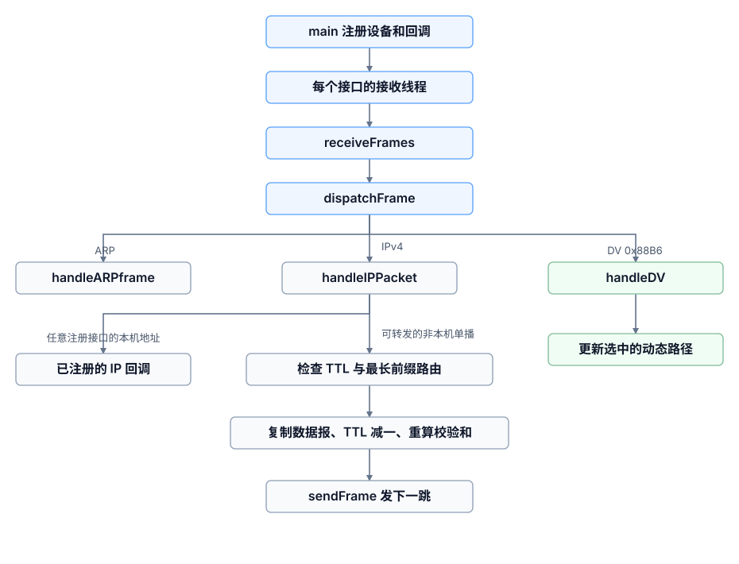
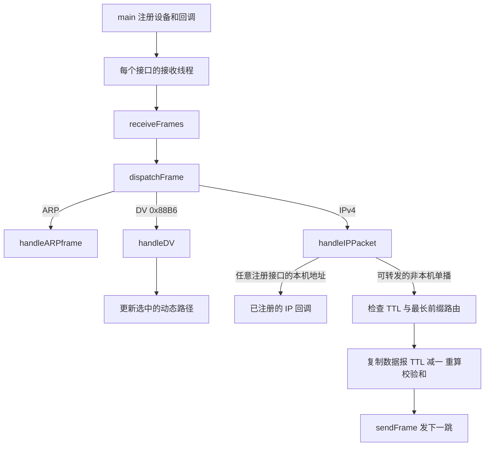

## Prepare

在 lab1 中，我们已经实现了网络设备的管理和链路层以太网 II 帧的收发，回顾一下已经实现的接口：

添加设备：

```c
/**
* Add a device to the library for sending/receiving packets.
*
* @param device Name of network device to send/receive packet on.
* @return A non -negative _device -ID_ on success , -1 on error.
*/
int addDevice(const char* device);
```

---

查找设备：

```c
/**
* Find a device added by ‘addDevice ‘.
*
* @param device Name of the network device.
* @return A non -negative _device -ID_ on success , -1 if no such device
* was found.
*/
int findDevice(const char* device);
```

---

清空设备 list

```c
void clearDevices(void);
```
具体而言，我们在 device.c 中实现了
```c
static Device devices_list[MAX_DEVICE_NUM];
static int num_devices = 0;
```

来完成对 device 的维护

---

获取设备句柄，返回一个借用的 `pcap_t *`。Lab 2 中同一设备拆成独立的 RX/TX 句柄，调用时需要指定方向；停止所有使用者以后才能调用 `clearDevices`

```c
typedef enum {
    DEVICE_RX,
    DEVICE_TX
} DeviceHandleType;

pcap_t *getDeviceHandle(int id, DeviceHandleType direction);
```

---

发送帧：

```c
/**
* @brief Encapsulate some data into an Ethernet II frame and send it.
*
* @param buf Pointer to the payload.
* @param len Length of the payload.
* @param ethtype EtherType field value of this frame.
* @param destmac MAC address of the destination.
* @param id ID of the device(returned by ‘addDevice ‘) to send on.
* @return 0 on success , -1 on error.
* @see addDevice
*/
int sendFrame(const void* buf, int len, int ethtype, const void* destmac, int id);
```

---

定义以太网帧回调函数（即对收到的每一帧如何进行处理）：

```c
/**
* @brief Process a frame upon receiving it.
*
* @param buf Pointer to the frame.
* @param len Length of the frame.
* @param id ID of the device (returned by ‘addDevice ‘) receiving
* current frame.
* @return 0 on success , -1 on error.
* @see addDevice
*/
typedef int (*frameReceiveCallback)(const void*, int, int);
```
具体而言，我们在 packetio.c 内部维护一个静态的回调变量 `static frameReceiveCallback receive_callback = NULL;` ，通过
```c
/**
* @brief Register a callback function to be called each time an
* Ethernet II frame was received.
*
* @param callback the callback function.
* @return 0 on success , -1 on error.
* @see frameReceiveCallback
*/
int setFrameReceiveCallback(frameReceiveCallback callback) {
    receive_callback = callback;
    return 0;
}
```
来设置具体的回调函数是什么，然后在

```c
/* Process count complete Ethernet frames synchronously.
 * count > 0 receives a finite number; count == -1 receives continuously.
 * Returns 0 on completion, -1 with errno on failure. May wait indefinitely.
 * Uses the callback registered at entry. NULL registration disables future calls.
 * Captured data is borrowed from libpcap and must be copied to retain it.
 */
int receiveFrames(int id, int count);
```

内部使用入口处注册的回调（即上面的 `receive_callback`）处理完整以太网帧。`count > 0` 时处理指定数量，`count == -1` 时持续接收；超时、过短和截断帧不计数。回调返回非零会停止本次接收，因此正常丢包应返回 0。注册回调应在启动接收线程之前完成。

## Goal

总的来说，lab2 的目标是在 lab1 的以太网收发基础上，手写一个符合题目要求的简化 IPv4 网络层，自行设计路由机制，再完成对应实验和报告。

Lab 2 共 **11 分**，任务如下：

| 任务 | 具体要求                                                     | 分值 |
| ---- | ------------------------------------------------------------ | ---- |
| WT2  | 用 Wireshark 查看给定 `trace.pcap`：分析 ARP 请求与回复的字段对应关系；统计 DF 位未设置的 IPv4 包；回答 IPv4、IPv6 首部长度问题 | 1    |
| PT3  | 扩展设备管理，基于 Lab 1 实现 IP 包收发、接收回调注册、手动添加路由表项；遵循 RFC 791 | 4    |
| WT3  | 解释上层只提供 IP 地址时，你如何解决 `sendFrame()` 需要目的 MAC 的问题 | 1    |
| WT4  | 描述你自己采用的路由算法                                     | 1    |
| CP3  | 抓取自己生成的 IP 包，给出一个包的十六进制内容并解释各字节含义 | 1    |
| CP4  | 四节点链式网络中，展示发现、断开后不可发现、重连后重新发现   | 1    |
| CP5  | 指定六节点拓扑中展示每对主机的距离；断开 ns5 后再次展示      | 1    |
| CP6  | 展示实现遵循最长前缀匹配                                     | 1    |

## Writing Task 2 (WT2)

> Open trace.pcap with Wireshark. Answer the following questions.
>
> 1. During an ARP interaction, which field in ARP Reply is the same as the Sender MAC address in ARP Request?
>
> 2. How many IPv4 packets are there whose Don’t fragment bit is not set?
> 3. What are the header lengths of IPv4 and IPv6 packets respectively (not including IP options)?

先回顾一下 **ARP** （Address Resolution Protocol，地址解析协议）：

> ARP（Address Resolution Protocol）在当前链路上建立 IPv4 地址到链路层地址的映射。典型流程为：
>
> 1. A 检查 ARP 缓存是否存在可用的 `192.168.1.1 → MAC_RL` 表项。
> 2. 若没有，广播 ARP Request：谁拥有 `192.168.1.1`？请告诉 `192.168.1.10`。
> 3. 网关通常向 A 单播 ARP Reply，给出自己的链路层地址。
> 4. A 缓存映射，再发送等待的 IP 数据报；若解析最终失败，则无法在这条链路上完成交付。
>
> 请求帧的目的 MAC 通常为 `ff:ff:ff:ff:ff:ff`。ARP 使用自己的以太网类型 `0x0806`，**不是封装在 IPv4 中的一条 IP 消息**。（直接封装在以太网帧中，因此这里并不存在把 ARP 请求的目的 IP 设置为 `255.255.255.255` 这一步。）ARP 广播通常不会被路由器转发到另一个网段，所以 A 不能靠一次本地广播直接查到远端 B 的 MAC。协议见 [RFC 826 ↗](https://www.rfc-editor.org/rfc/rfc826.html)。


主机 A 发出 ARP 广播以后：

1. 交换机 S1 收到这个以太网广播帧。
2. S1 将它从 VLAN 10 中除入端口外的其他转发端口**泛洪**出去。
3. 主机 B 收到广播并检查 ARP 中的目标 IP。
4. 路由器 R 的 VLAN 10 接口也可以收到广播，但不会把这个 ARP 请求作为广播帧转发给 VLAN 20 的主机 C。

所以，ARP 广播传播的边界是二层广播域。

> **跨子网通信时，ARP 查询的是谁？**
>
> 假设：
> - A：`192.168.1.10/24`
> - 默认网关：`192.168.1.1`
> - C：`192.168.2.20/24`
>
> A 想给 C 发送 IP 数据包。
>
> 首先，A 根据自己的子网掩码判断：
>
> $192.168.1.10/24 \quad\text{与}\quad 192.168.2.20/24$
>
> 不属于同一个 IP 子网。
>
> 于是 A 根据路由表决定将数据包交给默认网关。A 不会广播查询 C 的 MAC 地址，而是查询默认网关 `192.168.1.1` 的 MAC 地址。
>
> 发送：
>
> $\text{ARP: Who has 192.168.1.1?}$
>
> 得到网关的 MAC 地址后，A 发送的数据是：
>
> |      字段                     |      值       |
> | ----------------------------| ------------ |
> | IP Source                  | 192.168.1.10 |
> | IP Destination           | 192.168.2.20 |
> | Ethernet Source MAC      | A 的 MAC     |
> | Ethernet Destination MAC | 网关的 MAC   |
>
> 注意：IP 目的地址仍然是 C，只有以太网目的 MAC 地址指向下一跳网关。
>
> 路由器接收数据包后，根据路由表确定从哪个接口继续转发。如果 C 在该接口直连的以太网中，路由器可能再使用 ARP 查询 C 的 MAC 地址，然后构造一个新的以太网帧。
>
> 因此，这里可能发生两次不同的 ARP：
>
> - 第一次：A 在广播域 1 内查询网关 MAC。
> - 第二次：路由器在广播域 2 内查询 C 的 MAC。
>
> 两次 ARP 都只在各自的广播域内传播。

接下来开始作答：


### Question 1

>  During an ARP interaction, which field in ARP Reply is the same as the Sender MAC address in ARP Request?

显然，在 **ARP Reply** 中，与 **ARP Request 的 Sender MAC address** 相同的字段是：

**Target Hardware Address（目标硬件地址，也就是 Target MAC address）**

所以我们的回答是：**Target MAC address**

### Question 2

> How many IPv4 packets are there whose Don’t fragment bit is not set?

即统计抓包文件中，IPv4 首部的 DF（Don't Fragment）标志位为 0 的数据包数量。

| IPv4 字段           | 位数 | Wireshark 字段名 | 作用                        |
| ------------------- | ---- | ---------------- | --------------------------- |
| Version（版本）     | 4    | `ip.version`     | IP 协议版本，IPv4 为 4      |
| IHL（首部长度）     | 4    | `ip.hdr_len`     | 线上 IHL 以 4 字节为单位；Wireshark 字段显示字节数 |
| ToS / DS Field      | 8    | `ip.dsfield`     | 服务质量与拥塞通知          |
| Total Length        | 16   | `ip.len`         | IP 数据报总长度，单位为字节 |
| Identification      | 16   | `ip.id`          | 分片重组标识                |
| Flags               | 3    | `ip.flags`       | 控制 IP 分片                |
| Fragment Offset     | 13   | `ip.frag_offset` | 分片在原数据报中的位置      |
| TTL                 | 8    | `ip.ttl`         | 生存时间，防止无限转发      |
| Protocol            | 8    | `ip.proto`       | 上层协议类型                |
| Header Checksum     | 16   | `ip.checksum`    | IPv4 首部校验和             |
| Source Address      | 32   | `ip.src`         | 源 IPv4 地址                |
| Destination Address | 32   | `ip.dst`         | 目的 IPv4 地址              |
| Options             | 可变 | `ip.opt.type` 等 | 可选首部字段                |

Flags 占 3 bit，但 Wireshark 提供了各个标志位的独立过滤字段。

| 字段     | Wireshark 过滤字段 | 0 的含义     | 1 的含义     |
| -------- | ------------------ | ------------ | ------------ |
| Reserved | `ip.flags.rb`      | 正常         | 保留位被设置 |
| DF       | `ip.flags.df`      | 允许分片     | 禁止分片     |
| MF       | `ip.flags.mf`      | 没有后续分片 | 后面还有分片 |

所以 Wireshark 过滤表达式为：

```text
ip.flags.df == 0
```


在终端使用 tshark，也可以直接

```bash
tshark -r trace.pcap -Y "ip.flags.df == 0" | wc -l
```

用原始 `trace.pcap` 复核，匹配的是第 12、17、18、32、38、44 帧，共 **6 条**。DF 为 0 只表示允许分片，不代表这些包实际发生了分片；判断分片还要看 MF 和 Fragment Offset。字段定义可查 [Wireshark IPv4 显示过滤器参考](https://www.wireshark.org/docs/dfref/i/ip.html)。

### Question 3

> What are the header lengths of IPv4 and IPv6 packets respectively (not including IP options)?

- IPv4：本题排除选项，答案是 **20 字节**。一般情况下 IHL 允许首部为 20～60 字节。


首部大于 20 字节的 IPv4 数据包：


很不幸，并没有找到（悲）

- IPv6：基本首部固定为 **40 字节**，没有 IHL 字段；扩展首部另计。见 [RFC 8200 §3](https://www.rfc-editor.org/rfc/rfc8200.html#section-3)。下图高亮部分正好是 40 字节。


## Programming Task 3 (PT3)

Update the method in `device.h`, Use the library in `packetio.h` to implement the following methods to support sending/receiving IP packets. You should follow [RFC791](https://www.rfc-editor.org/info/rfc791/#section-2.1) when working on this.

> **Hints and Instructions**
>
> - Check your byte order!!
> - When designing a usable system, you should always take all corner
>   cases into consideration. Describe what corner cases your system met
>   and your solution during the development process in the writing tasks.
> - You are not required to implement IP packet fragmentation, simply
>   drop fragmented packets is OK.
> - You are not required to support TOS and IP options. Use a default
>   value when sending, ignore them when receiving.
> - Your implementation should be reentrant.

题目给出的接口概述如下。当前实现中，手工路由接口声明已移到 `smtroute.h`，由路由模块统一维护：

```c
/**
 * @file ip.h
 * @brief Library supporting sending/receiving IP packets encapsulated in an Ethernet II frame.
 */

#include <netinet/ip.h>

/**
* @brief Send an IP packet to specified host.
*
* @param src Source IP address.
* @param dest Destination IP address.
* @param proto Value of ‘protocol ‘ field in IP header.
* @param buf pointer to IP payload
* @param len Length of IP payload
* @return 0 on success , -1 on error.
*/
int sendIPPacket(const struct in_addr src , const struct in_addr dest ,
int proto , const void *buf , int len);

/**
* @brief Process an IP packet upon receiving it.
*
* @param buf Pointer to the packet.
* @param len Length of the packet.
* @return 0 on success , -1 on error.
* @see addDevice
*/
typedef int (* IPPacketReceiveCallback)(const void* buf , int len);

/**
* @brief Register a callback function to be called each time an IP
packet was received.
*
* @param callback The callback function.
* @return 0 on success , -1 on error.
* @see IPPacketReceiveCallback
*/
int setIPPacketReceiveCallback(IPPacketReceiveCallback callback);

/**
* @brief Manully add an item to routing table. Useful when talking
with real Linux machines.
*
* @param dest The destination IP prefix.
* @param mask The subnet mask of the destination IP prefix.
* @param nextHopMAC MAC address of the next hop.
* @param device Name of device to send packets on.
* @return 0 on success , -1 on error
*/
int setRoutingTable(const struct in_addr dest ,
const struct in_addr mask ,
const void* nextHopMAC , const char *device);
```

:::study-note[netinet/ip.h 和 IPv4 Header]{kind="note" open="true"}

`#include <netinet/ip.h>` 是 C 语言网络编程中用于处理 IPv4 数据报首部（IPv4 Header） 的头文件。它主要定义了 结构体（struct）和宏（macro），而不是用于发送、接收数据包的函数接口。

以 Linux 的 glibc 实现为例：

| 类型   | 名称                  | 作用                       |
| ------ | --------------------- | -------------------------- |
| 结构体 | `struct iphdr`        | Linux 风格的 IPv4 首部     |
| 结构体 | `struct ip`           | BSD 风格的 IPv4 首部       |
| 结构体 | `struct ip_timestamp` | IPv4 时间戳选项            |
| 结构体 | `struct timestamp`    | 时间戳数据结构             |
| 宏     | `IPVERSION`           | IPv4 版本号，值为 4        |
| 宏     | `IP_MAXPACKET`        | IPv4 数据报最大长度，65535 |
| 宏     | `IP_DF`、`IP_MF`      | IPv4 分片标志              |
| 宏     | `IP_OFFMASK`          | 提取分片偏移的掩码         |
| 宏     | `IPOPT_*`             | IPv4 Options 相关常量      |
| 宏     | `IPTOS_*`             | 服务类型、DSCP、ECN 等字段 |
| 宏     | `MAXTTL`、`IPDEFTTL`  | TTL 相关常量               |

**最重要的结构体**：`struct ip`

```c
struct ip {
    unsigned int ip_hl:4;      // Header Length
    unsigned int ip_v:4;       // Version
    uint8_t ip_tos;            // DSCP + ECN
    unsigned short ip_len;     // Total Length
    unsigned short ip_id;      // Identification
    unsigned short ip_off;     // Flags + Fragment Offset
    uint8_t ip_ttl;            // Time To Live
    uint8_t ip_p;              // Protocol
    unsigned short ip_sum;     // Header Checksum
    struct in_addr ip_src;     // Source IP
    struct in_addr ip_dst;     // Destination IP
};
```

注意：这里展示的是小端平台上的位字段顺序，大端平台的前两个位字段声明顺序相反。

它和 Wireshark 中的 IPv4 Header 一一对应：


其中需要特别理解的是：

- `ip_hl`：IPv4 首部长度，单位为 4 字节。因此实际长度为 `ip_hl * 4`。
- `ip_len`：整个 IPv4 数据报长度，包括首部和数据。
- `ip_off`：包含 3 个 Flags 位和 13 个 Fragment Offset 位。
- `ip_p`：标识上层协议，例如 TCP = 6、UDP = 17、ICMP = 1。

:::

首先，我们回顾一下数据是如何进行传输的。

对于通常的计算机网络通信，只要数据需要通过实际的网络链路从一个设备传输到另一个设备，就必须使用该链路所支持的链路层封装。

假设主机 A 想向主机 B 发送一个 IPv4 数据报。

IPv4 Header 包含：

```
Source IP:      192.168.1.10
Destination IP: 192.168.1.20
Protocol:       TCP
TTL:            64
```

问题是：网卡如何把这个 IP 数据报发送到实际的网络链路上？

IP 协议本身并没有规定具体的物理传输方式。例如：

- Ethernet 使用以太网帧。
- Wi-Fi 使用 IEEE 802.11 MAC 帧。

因此，在以太网环境中，需要把 IP 数据报封装到 Ethernet Frame 中。最终，以太网发送的是符合以太网链路规范的帧，而不是直接把一个没有封装的 IP 数据报放到以太网链路上。

跨越多个网络时，每一跳都需要重新进行链路层封装，例如：


假设主机 A 通过 Ethernet 连接路由器，路由器通过 Wi-Fi 连接主机 B。

传输过程：

1. A 将 IP 数据报封装为 Ethernet Frame。
2. 路由器接收并解析 Ethernet Frame，取出 IP 数据报。
3. 路由器检查 IP Header，查询路由表，更新 TTL 等字段。
4. 路由器把 IP 数据报重新封装为 IEEE 802.11 Frame。
5. 主机 B 接收 Wi-Fi 帧，取出 IP 数据报。

因此：IP 数据报可以跨越不同类型的网络，但每一跳的链路层帧格式都必须符合对应链路的协议。

先重新捋一捋 Lab 1 的接口：`sendFrame` 接收 payload、EtherType、目的 MAC 和设备 ID，负责封装并发送以太网 II 帧；`receiveFrames` 在指定设备监听完整帧，再交给已注册的回调处理。IPv4 层要复用的是这套封装和收发能力。

`sendIPPacket` 要把上层 payload 封装成 IPv4 数据报，再按目的 IP 查询路由，得到出接口与下一跳 MAC，最后调用 `sendFrame`。当前实现有两条主要的 MAC 来源：手工路由直接提供 MAC，动态路由保存 DV 通告帧的源 MAC。两者正常情况下都不需要额外 ARP。

传统 IP 路由常保存下一跳 IP，再由邻居解析获得 MAC；本实验接口直接接收 `nextHopMAC`，所以不能把一般网络原理中的这条流程原样当作当前代码的调用链。零 MAC 时保留的 ARP 分支及其限制，后文单独说明。

各模块最终承担的职责如下，后面逐项展开：

| 文件 | 职责 |
| --- | --- |
| `device.c` | 缓存接口名、MAC 和第一个 IPv4 地址，维护 RX/TX 句柄，判断本机地址 |
| `packetio.c` | 以太网帧封装、填充、发送和同步接收，注册帧回调 |
| `ip.c` | IPv4 首部构造、发送、接收校验、本地交付和转发 |
| `smtarp.c` | ARP 请求、应答和缓存 |
| `smtroute.c` | 手工与本机路由、最长前缀查询、DV 收发和超时清理 |
| `main.c` | 初始化、接收线程、按 EtherType 分发、周期维护和通告 |

### 总体架构：接收、分发与转发

各接口的接收线程通过 `receiveFrames` 接收以太网帧，再由 `dispatchFrame` 根据 EtherType 分派。IPv4 数据报在校验后分别进入本机交付或单播转发；DV 通告用于更新动态路由。



:::study-note[查看 Mermaid 源码]{kind="note"}



:::

图中展示的是接收与转发主线；`main` 还会周期性维护路由并发送 DV 通告，`sendIPPacket` 则负责本机发起的数据报发送，后文分别说明。

---

### 设备与链路层接口：`device.h` / `device.c`、`packetio.h` / `packetio.c`

Lab 1 已经完成了设备注册和以太网收发。Lab 2 又为每个设备区分 RX/TX 句柄，并缓存接口的 IPv4 地址，供本机地址判断和路由初始化使用。`device.h` 的实际声明如下：

```c
/**
* @file device.h
* @brief Library supporting network device management.
*/

#ifndef DEVICE_H
#define DEVICE_H
#include <pcap.h>
#include <netinet/in.h>

/**
* Add a device to the library for sending/receiving packets.
*
* @param device Name of network device to send/receive packet on.
* @return A non -negative _device -ID_ on success , -1 on error.
*/
int addDevice(const char* device);

/**
* Find a device added by ‘addDevice ‘.
*
* @param device Name of the network device.
* @return A non -negative _device -ID_ on success , -1 if no such device
* was found.
*/
int findDevice(const char* device);

// 返回已注册设备的名称
const char* getDeviceName(int id);

void clearDevices(void);

typedef enum {
    DEVICE_RX,
    DEVICE_TX
} DeviceHandleType;

/* Borrow the selected handle; invalid IDs/directions return NULL.
 * RX is for the receiving thread. TX is for sending; sendFrame serializes
 * injection. Direct TX users need their own coordination with sendFrame.
 * Stop all users before clearDevices().
 */
pcap_t *getDeviceHandle(int id, DeviceHandleType direction);

int getDeviceMAC(int id, unsigned char mac[6]);

/* Copy the first IPv4 address found when addDevice registered the interface.
 * The address stays in network byte order. Returns 0 on success, -1 for an
 * invalid ID/output pointer or no cached IPv4 address. Configure addresses
 * before addDevice; clear and register again to refresh the cached address.
 */
int getDeviceip(int id, struct in_addr* ip);

// 判断是否为任意已注册接口的缓存 IPv4 地址，返回 1 或 0。
int isLocalIP(const struct in_addr ip);

#endif
```

`device.c` 中的查询函数从注册时保存的信息读取地址；`isLocalIP` 会检查所有已注册接口。这里摘出这三个实际函数：

```c
int getDeviceMAC(int id, unsigned char mac[6]) {
    if (id < 0 || id >= num_devices || mac == NULL) {
        return -1;
    }

    memcpy(mac, devices_list[id].mac, 6);
    return 0;
}

int getDeviceip(int id, struct in_addr* ip) {
    if (id < 0 || id >= num_devices || ip == NULL || devices_list[id].ip.s_addr == 0) {
        return -1;
    }

    *ip = devices_list[id].ip;
    return 0;
}

int isLocalIP(const struct in_addr ip) {
    if (ip.s_addr == 0) return 0;
    for (int i = 0; i < num_devices; i++) {
        if (devices_list[i].ip.s_addr == ip.s_addr) return 1;
    }
    return 0;
}
```

`packetio.h` 的实际声明如下。`receiveFrames` 支持固定数量或持续接收，`sendFrame` 的发送注入由内部互斥锁串行化：

```c
/**
* @file packetio.h
* @brief Library supporting sending/receiving Ethernet II frames.
*/

#ifndef PACKETIO_H
#define PACKETIO_H

#include <net/ethernet.h>

/**
* @brief Encapsulate some data into an Ethernet II frame and send it.
*
* @param buf Pointer to the payload.
* @param len Length of the payload.
* @param ethtype EtherType field value of this frame.
* @param destmac MAC address of the destination.
* @param id ID of the device(returned by ‘addDevice ‘) to send on.
* @return 0 on success , -1 on error.
* @see addDevice
*/
// 多个 sendFrame 调用之间的实际注入由内部互斥锁保护。
int sendFrame(const void* buf, int len, int ethtype, const void* destmac, int id);


/**
* @brief Process a frame upon receiving it.
*
* @param buf Pointer to the frame.
* @param len Length of the frame.
* @param id ID of the device (returned by ‘addDevice ‘) receiving
* current frame.
* @return 0 on success , -1 on error.
* @see addDevice
*/
typedef int (*frameReceiveCallback)(const void*, int, int);

/**
* @brief Register a callback function to be called each time an
* Ethernet II frame was received.
*
* @param callback the callback function.
* @return 0 on success , -1 on error.
* @see frameReceiveCallback
*/
int setFrameReceiveCallback(frameReceiveCallback callback);

/* Process count complete Ethernet frames synchronously;
 * count == -1 (pcap_loop) or count > 0
 * Uses the callback registered at entry. NULL registration disables future calls.
 * Captured data is borrowed from libpcap and must be copied to retain it.
 */
int receiveFrames(int id, int count);

#endif
```

`packetio.c` 保留以太网封装和同步接收的职责；实际发送时，多个 `sendFrame` 调用在注入阶段使用同一把锁。下面是收发函数的实际代码：

```c
int sendFrame(const void* buf, int len, int ethtype, const void* destmac, int id) {
    if (len < 0) {
        return frameError("payload length must not be negative", EINVAL);
    }
    if (len > 1500) {
        return frameError("payload exceeds the 1500-byte limit", EMSGSIZE);
    }
    if (len > 0 && buf == NULL) {
        return frameError("non-empty payload requires a buffer", EINVAL);
    }
    if (destmac == NULL) {
        return frameError("destination MAC is NULL", EINVAL);
    }
    if (ethtype < 0x0600 || ethtype > 0xffff) {
        return frameError("EtherType must be between 0x0600 and 0xffff", EINVAL);
    }

    pcap_t *handle = getDeviceHandle(id, DEVICE_TX);
    if (handle == NULL) {
        return frameError("device ID is not registered", ENODEV);
    }
    unsigned char srcmac[6];
    if (getDeviceMAC(id, srcmac) != 0) {
        return frameError("cannot obtain the cached source MAC", EIO);
    }

    size_t frame_len = 14 + (size_t)len;
    if (frame_len < 60) {
        frame_len = 60;
    }

    unsigned char *frame = calloc(frame_len, 1);
    if (frame == NULL) {
        return frameError("cannot allocate frame buffer", ENOMEM);
    }
    memcpy(frame, destmac, 6);
    memcpy(frame + 6, srcmac, 6);
    frame[12] = (unsigned char)((ethtype >> 8) & 0xff);
    frame[13] = (unsigned char)(ethtype & 0xff);
    if (len > 0) memcpy(frame + 14, buf, (size_t)len);

    // 周期 DV 与接收线程的应答可能同时发送，保护 TX 句柄和错误信息。
    pthread_mutex_lock(&send_mutex);
    int sent = pcap_inject(handle, frame, frame_len);
    if (sent < 0) {
        int result = frameError(pcap_geterr(handle), EIO);
        pthread_mutex_unlock(&send_mutex);
        free(frame);
        return result;
    }
    pthread_mutex_unlock(&send_mutex);
    free(frame);
    if ((size_t)sent != frame_len) {
        return frameError("incomplete send", EIO);
    }
    return 0;
}

int receiveFrames(int id, int count) {
    if (count == 0 || count < -1) {
        return receiveError("count must be positive or -1", EINVAL);
    }
    if (receive_callback == NULL) {
        return receiveError("no frame callback is registered", EINVAL);
    }
    pcap_t *handle = getDeviceHandle(id, DEVICE_RX);
    if (handle == NULL) {
        return receiveError("device ID is not registered", ENODEV);
    }
    int link_type = pcap_datalink(handle);
    if (link_type < 0) {
        return receiveError(pcap_geterr(handle), EIO);
    }
    if (link_type != DLT_EN10MB) {
        return receiveError("capture device does not provide Ethernet frames", EPROTONOSUPPORT);
    }

    /* Keep this call's callback stable, even if it changes registration. */
    frameReceiveCallback callback = receive_callback;
    int processed = 0;
    while (count == -1 || processed < count) {
        struct pcap_pkthdr *header = NULL;
        const unsigned char *data = NULL;
        int result = pcap_next_ex(handle, &header, &data);
        switch (result) {
        case 0:
            continue;
        case PCAP_ERROR_BREAK:
            if (count == -1) return 0;
            return receiveError("capture ended before count was reached", EPIPE);
        case 1: {
            if (header == NULL || data == NULL) {
                return receiveError("capture returned missing frame data", EIO);
            }
            if (header->caplen < 14 || header->caplen < header->len) {
                continue;
            }
            if (header->caplen > INT_MAX) {
                return receiveError("captured frame exceeds callback length range", EMSGSIZE);
            }
            if (callback(data, (int)header->caplen, id) != 0) {
                return receiveError("frame callback reported failure", EIO);
            }
            // Unlimited reception does not need a counter that could overflow.
            if (count != -1) processed++;
            break;
        }
        default:
            return receiveError(pcap_geterr(handle), EIO);
        }
    }
    return 0;
}
```

接下来按各网络层模块查看头文件与实现。

### ARP 实现：`smtarp.h` / `smtarp.c`

`smtarp.h` 声明请求、应答、缓存查找和接收处理接口：

```c
#ifndef SMTARP_H
#define SMTARP_H
#include <netinet/ip.h>

// 发送 ARP Request
int sendARPRequest(const struct in_addr src_ip,
    const struct in_addr target_ip, int id);

int sendARPReply(const struct in_addr src_ip, const struct in_addr target_ip,
    uint8_t* target_mac, int id);

// 查 ARP 缓存
int searchARPcache(const struct in_addr target_ip, uint8_t* reture_mac);

// buf 从 ARP 头开始，len 为以太网载荷长度（可能包含填充），id 为接收接口。
int handleARPframe(const void* buf, int len, int id);

#endif
```

#### ARP 报文、缓存与收发


Linux 的 `<netinet/if_ether.h>` 定义了 `struct ether_arp`，包含固定头以及发送方、目标方的硬件地址和协议地址：

```c
struct ether_arp {
    struct arphdr ea_hdr;
    uint8_t arp_sha[6];
    uint8_t arp_spa[4];
    uint8_t arp_tha[6];
    uint8_t arp_tpa[4];
};
```


| 字段 | 字节数 | Ethernet / IPv4 ARP 中的值 |
| --- | --- | --- |
| Hardware Type | 2 | 1，Ethernet |
| Protocol Type | 2 | `0x0800`，IPv4 |
| Hardware / Protocol Address Length | 1 + 1 | 6 / 4 |
| Operation | 2 | 1 为 Request，2 为 Reply |
| Sender Hardware / Protocol Address | 6 + 4 | 发送者 MAC / IPv4 |
| Target Hardware / Protocol Address | 6 + 4 | 目标 MAC / IPv4；请求的目标 MAC 通常全零 |

这些字段共 28 字节。**以太网头的 EtherType 是 `0x0806`，ARP 头里的 Protocol Type 是 `0x0800`**，两者处在不同层次。

`sendARPRequest` 填入本接口 MAC、源 IP 和待解析 IP，以广播 MAC 调用 `sendFrame`。`sendARPReply` 则把请求者作为目标，以单播帧回复。

请求与应答的具体实现分别是：

```c
int sendARPRequest(const struct in_addr src_ip,
    const struct in_addr target_ip, int id) {

    uint8_t broadcast_mac[6];
    for (int i = 0; i < 6; i++) broadcast_mac[i] = 0xff;

    unsigned char src_mac[6];
    if (getDeviceMAC(id, src_mac) == -1) return -1;

    struct ether_arp arp = {0};
    arp.ea_hdr.ar_hrd = htons(ARPHRD_ETHER);
    arp.ea_hdr.ar_pro = htons(ETHERTYPE_IP);
    arp.ea_hdr.ar_hln = 6;
    arp.ea_hdr.ar_pln = 4;
    arp.ea_hdr.ar_op = htons(ARPOP_REQUEST);

    memcpy(arp.arp_sha, src_mac, 6);
    memcpy(arp.arp_spa, &src_ip.s_addr, 4);
    memcpy(arp.arp_tpa, &target_ip.s_addr, 4);

    return sendFrame(
        &arp,
        sizeof(arp),
        ETHERTYPE_ARP,
        broadcast_mac,
        id
    );
}

int sendARPReply(const struct in_addr src_ip, const struct in_addr target_ip,
uint8_t* target_mac, int id) {
    if (target_mac == NULL) return -1;

    unsigned char src_mac[6];
    if (getDeviceMAC(id, src_mac) == -1) return -1;

    struct ether_arp arp = {0};
    arp.ea_hdr.ar_hrd = htons(ARPHRD_ETHER);
    arp.ea_hdr.ar_pro = htons(ETHERTYPE_IP);
    arp.ea_hdr.ar_hln = 6;
    arp.ea_hdr.ar_pln = 4;
    arp.ea_hdr.ar_op = htons(ARPOP_REPLY);

    memcpy(arp.arp_sha, src_mac, 6);
    memcpy(arp.arp_spa, &src_ip.s_addr, 4);
    memcpy(arp.arp_tha, target_mac, 6);
    memcpy(arp.arp_tpa, &target_ip.s_addr, 4);

    return sendFrame(
        &arp,
        sizeof(arp),
        ETHERTYPE_ARP,
        target_mac,
        id
    );
}
```

接收时，`handleARPframe` 先复制到局部结构体，避免直接解引用以太网载荷处可能未对齐的数据。若请求的目标 IP 是接收接口的缓存地址，就回复，然后有意落入缓存更新分支，记录请求者的 IP/MAC；收到 Reply 也更新缓存。这里的 `/* fall through */` 是说明有意贯穿，不能在 Request 分支末尾随手加 `break`。

缓存查找与接收处理代码如下。注意 Request 处理后有意继续进入 Reply 的缓存更新分支：

```c
int searchARPcache(const struct in_addr target_ip, uint8_t* return_mac) {
    if (return_mac == NULL) return -1;

    int result = -1;
    pthread_mutex_lock(&arp_mutex);
    for (int i = 0; i < arp_num; i++) {
        if (arplist[i].ip.s_addr == target_ip.s_addr) {
            memcpy(return_mac, arplist[i].mac, 6);
            result = 0;
            break;
        }
    }
    pthread_mutex_unlock(&arp_mutex);
    return result;
}

int handleARPframe(const void* buf, int len, int id) {
    if (buf == NULL || len < (int)sizeof(struct ether_arp)) return -1;

    struct ether_arp arp;
    memcpy(&arp, buf, sizeof(arp));

    struct in_addr sender_ip;
    struct in_addr target_ip;
    memcpy(&sender_ip.s_addr, arp.arp_spa, 4);
    memcpy(&target_ip.s_addr, arp.arp_tpa, 4);

    uint8_t sender_mac[6];
    memcpy(&sender_mac, arp.arp_sha, 6);

    uint16_t op = ntohs(arp.ea_hdr.ar_op);
    struct in_addr src_ip;
    if (getDeviceip(id, &src_ip) == -1) return -1;

    switch (op) {
        case ARPOP_REQUEST:
            if (src_ip.s_addr != target_ip.s_addr) return 0;
            sendARPReply(src_ip, sender_ip, sender_mac, id);
            /* fall through */
        case ARPOP_REPLY:
            pthread_mutex_lock(&arp_mutex);
            for (int i = 0; i < arp_num; i++) {
                if (sender_ip.s_addr == arplist[i].ip.s_addr) {
                    memcpy(arplist[i].mac, sender_mac, 6);
                    pthread_mutex_unlock(&arp_mutex);
                    return 0;
                }
            }
            if (arp_num >= MAX_ARP_SIZE) {
                pthread_mutex_unlock(&arp_mutex);
                return -1;
            }
            arplist[arp_num].ip = sender_ip;
            memcpy(arplist[arp_num].mac, sender_mac, 6);
            arp_num++;
            pthread_mutex_unlock(&arp_mutex);
            return 0;
        default:
            return 0;
    }

}
```

缓存容量为 128，以 IP 为键，用 `arp_mutex` 保护读写。已经存在的 IP 更新 MAC，新 IP 在容量允许时追加。

这仍是简化的实验模块：缓存没有按接口区分，也没有老化机制；接收端尚未完整验证 Hardware Type、Protocol Type、地址长度和应答来源。互斥锁解决了并发访问，不代表已经实现完整的邻居状态管理。

### 静态与动态路由实现：`smtroute.h` / `smtroute.c`

`smtroute.h` 包含路由项、距离向量协议常量，以及路由初始化、查询、收发和维护接口：

```c
#ifndef SMTROUTE_H
#define SMTROUTE_H
#include <netinet/in.h>
#include <stdint.h>

#define ETHERTYPE_DV 0x88b6

#define DV_VERSION 1
#define DV_INFINITY 16
#define DV_HEADER_LEN 4
#define DV_ENTRY_LEN 12

#define DV_ROUTE_TIMEOUT 5
#define DV_GARBAGE_TIME 5

// DV 载荷：版本(1)、保留零(1)、网络序条目数(2)。
// 每项：目的前缀(4)、掩码(4)、网络序代价(4)。

typedef struct {
    struct in_addr dest;
    struct in_addr mask;
    struct in_addr nextHopIP;
    uint8_t nextHopMAC[6]; // {0, 0, 0, 0, 0, 0} 表示不提供
    char device[128];

    uint8_t metric;

    uint64_t last_update; // 最后采纳可达通告的时钟秒数
    uint64_t invalid_since; // 首次变为不可达的时钟秒数
    int learned_from_dv;
    int valid; // 路由有效性
} RouteEntry;

/**
* @brief Manully add an item to routing table. Useful when talking
with real Linux machines.
*
* @param dest The destination IP prefix.
* @param mask The subnet mask of the destination IP prefix.
* @param nextHopMAC MAC address of the next hop.
* @param device Name of device to send packets on.
* @return 0 on success , -1 on error
*/
int setRoutingTable(const struct in_addr dest ,
const struct in_addr mask ,
const void* nextHopMAC , const char *device);

// 初始化指定接口的本机 /32 路由
int initRoutingTable(int id);

// 检查动态路由超时，清理保留期结束的不可达条目。
int updateRoutingTable(void);

// 最长前缀匹配；返回当前线程的副本，下次同线程查询时覆盖
RouteEntry* findRouter(const struct in_addr ip);

// 在指定接口广播距离向量；成功返回 0，失败返回 -1。
int sendDV(int id);

// 处理 DV 载荷，邻居由接收接口和源 MAC 标识
int handleDV(const void* buf, int len, int id, const void* srcMAC);

#endif
```

#### 手工路由与最长前缀匹配


先回顾一下路由表的概念：

> 路由表是从「目的 IP 地址」到「下一跳 IP 地址 + 出接口」的映射规则。
>
> 它解决的不是“数据最终发给谁”，而是已经知道数据包的最终目的 IP，现在应该从哪个网络接口发出去？应该先交给哪台设备？
>
> 考虑以下路由表：
>
> | Destination      | Next Hop        | Interface |
> | ---------------- | --------------- | --------- |
> | `192.168.1.0/24` | Direct          | eth0      |
> | `10.0.0.0/24`    | Direct          | eth1      |
> | `172.16.0.0/16`  | `10.0.0.254`    | eth1      |
> | `172.16.5.0/24`  | `192.168.1.254` | eth0      |
> | `0.0.0.0/0`      | `192.168.1.254` | eth0      |
>
> Destination：目的网络前缀
>
> 它不是某一个目的 IP，而是一个 IP 地址集合。
>
> 例如：
>
> - `192.168.1.0/24` 匹配 `192.168.1.0` 至 `192.168.1.255`。
> - `172.16.0.0/16` 匹配 `172.16.0.0` 至 `172.16.255.255`。
> - `0.0.0.0/0` 匹配所有 IPv4 地址。
>
> Next Hop：下一跳
>
> 表示数据包接下来应该交给哪个路由器。
>
> 如果写的是 `Direct`，则表示目标所在网络直接连接在出接口上，不需要经过另一个 IP 路由器。此时实际的链路层下一跳就是目的主机本身。
>
> Interface：出接口
>
> 表示从本机的哪一个接口发出。
>
> 例如 `eth0` 或 `eth1`，在你的程序中可以关联相应的 `pcap_t *handle`。
>
> 注意：同一个接口可以承载通往无数个不同目的网络的数据包。
>
> ---
>
> **路由表如何匹配目的 IP？**
>
> Longest Prefix Matching（最长前缀匹配）。
>
> IPv4 地址由 32 位组成。
>
> 例如：
>
> ```
> IP:       192.168.1.20
> Mask:     255.255.255.0
> Prefix:   /24
> ```
>
> 它表示 IP 地址的前 24 位是网络前缀。
>
> 网络地址可以通过按位与运算得到：
>
> $$
> \text{Network}=\text{IP}\ \&\ \text{Mask}
> $$
>
> ```
> IP:       192.168.1.20
> Mask:     255.255.255.0
>           ---------------
> Network:  192.168.1.0
> ```
>
> 因此，这个 IP 属于 `192.168.1.0/24` 网络。
>
> 一个目的 IP 是否匹配某条路由，本质上就是检查：
>
> $$
> \boxed{ (\text{Destination IP}\ \&\ \text{Mask}) = (\text{Route Network}\ \&\ \text{Mask}) }
> $$
>
> ---
>
> **为什么要选择最长前缀？**
>
> 考虑两条路由：
>
> ```
> 172.16.0.0/16   → eth1
> 172.16.5.0/24   → eth0
> ```
>
> 目的地址是：
>
> ```
> 172.16.5.10
> ```
>
> 它既匹配 `/16`，也匹配 `/24`。
>
> 应该选择哪条？
>
> 答案是 `/24`，因为它的网络前缀更长，匹配范围更具体。

实际代码把路由表集中放在 `smtroute.c`，`ip.c` 只调用路由接口。上面的 `smtroute.h` 中定义了 `RouteEntry`，主要字段如下：

```c
typedef struct {
    struct in_addr dest;
    struct in_addr mask;
    struct in_addr nextHopIP;
    uint8_t nextHopMAC[6];
    char device[128];
    uint8_t metric;
    uint64_t last_update;
    uint64_t invalid_since;
    int learned_from_dv;
    int valid;
} RouteEntry;
```

`smtroute.c` 内维护容量为 64 的数组、当前条目数和 `route_mutex`。`dest`、`mask` 决定一条前缀的身份；MAC 和设备名决定当前该往哪里发；其余字段用于距离向量和失效管理。

手工路由的实际实现如下。这里保留参数检查、查重、锁和字段初始化，便于对照代码中的每一个返回分支：

```c
int setRoutingTable(const struct in_addr dest ,
const struct in_addr mask ,
const void* nextHopMAC , const char *device) {
   if (nextHopMAC == NULL || device == NULL) return -1;

   size_t name_len = strlen(device);
   if (name_len >= sizeof(RoutingTable[0].device)) return -1;

   pthread_mutex_lock(&route_mutex);

   if (Route_num >= MAX_ROUTE_NUM) {
        pthread_mutex_unlock(&route_mutex);
        return -1;
   }

   for (int i = 0; i < Route_num; i++) {
        if (dest.s_addr == RoutingTable[i].dest.s_addr && mask.s_addr == RoutingTable[i].mask.s_addr) {
            pthread_mutex_unlock(&route_mutex);
            return 0;
        }
   }

   RouteEntry* entry = &RoutingTable[Route_num];
   entry->dest = dest;
   entry->mask = mask;
   entry->nextHopIP.s_addr = 0;
   memcpy(entry->nextHopMAC, nextHopMAC, 6);
   memcpy(entry->device, device, name_len + 1);

   // 手工条目的通告代价默认 1，不参与动态超时。
   entry->metric = 1;
   entry->last_update = 0;
   entry->invalid_since = 0;
   entry->learned_from_dv = 0;
   entry->valid = 1;
   Route_num++;
   pthread_mutex_unlock(&route_mutex);

   return 0;
}
```

`setRoutingTable(dest, mask, nextHopMAC, device)` 直接保存下一跳 MAC，`nextHopIP` 置零。新条目的 `metric=1`、`valid=1`、`learned_from_dv=0`，两个时间字段清零，因此不参与动态路由超时。这里的 1 是手工条目的默认通告代价，不是测量出的网络距离。

当前接口还有几个容易忽略的行为：

- 检查空指针、设备名长度和表容量，但没有验证设备确已注册、MAC 是否为有效单播、掩码是否连续，或自动规范化网络地址。调用方应提供合法配置，例如 `172.16.5.0/24`。
- 相同 `(dest, mask)` 已存在时返回 0，**不会覆盖原条目**；检查容量发生在查重之前，因此满表时重复添加也返回 -1。
- 动态接收不会覆盖已有的本机或手工条目；反过来，重复调用这个添加接口也不能把已有动态条目转换成手工条目。

最长前缀查询 `findRouter` 跳过 `valid=0` 或 `metric>=16` 的条目，先检查 `(ip & mask) == dest`，再选掩码中 1 的数量最多的一项。把 1 的数量解释为前缀长度，依赖掩码连续这个前提：DV 接收会检查，手工输入由调用方保证。

`findRouter` 的完整实现如下：遍历有效项，比较掩码长度，最后在锁内复制结果。

```c
RouteEntry* findRouter(const struct in_addr ip) {
    static _Thread_local RouteEntry result;
    pthread_mutex_lock(&route_mutex);

    int cur_mask_len = -1;
    int cur_router_num = -1;
    for (int i = 0; i < Route_num; i++) {
        if (!RoutingTable[i].valid || RoutingTable[i].metric >= DV_INFINITY) continue;
        struct in_addr dest = RoutingTable[i].dest;
        struct in_addr mask = RoutingTable[i].mask;
        if ((ip.s_addr & mask.s_addr) != dest.s_addr) continue;
        int mask_len = 0;
        for (int j = 31; j >= 0; j--) {
            if ((((unsigned int)1)<<j) & mask.s_addr) mask_len++;
        }
        if (cur_mask_len != -1 && cur_mask_len >= mask_len) continue;
        cur_mask_len = mask_len;
        cur_router_num = i;
    }
    if (cur_router_num >= 0) result = RoutingTable[cur_router_num];
    pthread_mutex_unlock(&route_mutex);
    return cur_router_num < 0 ? NULL : &result;
}
```

查询结果是 `_Thread_local` 的条目副本，锁内复制、锁外使用。调用方不能释放它，也不能通过修改它更新全局路由表；同一线程下一次查询会覆盖这个副本。

#### 距离表示到同一前缀的代价

当前算法借鉴分布式 Bellman–Ford：邻居通告到前缀 P 的距离，本机把到邻居的一跳加上去，作为经该邻居的候选距离。线上和本地都用 **16 表示不可达**，可用代价为 0～15。

```text
候选代价 = min(邻居通告代价 + 1, 16)
```

本机起始条目来自每个已注册接口的第一个缓存 IPv4 地址，建立 `/32` 路由，距离为 0。例如 B 有两个接口地址，就起始拥有两个本机 `/32`；每个地址都在所有接口正常通告。当前不会读取接口掩码后自动宣告整个直连子网，也不会枚举同一接口的全部别名地址。

每个接口的本机 `/32` 由 `initRoutingTable` 初始化：

```c
int initRoutingTable(int id) {
    const char* device = getDeviceName(id);
    struct in_addr ip;
    uint8_t mac[6];
    if (device == NULL || getDeviceip(id, &ip) != 0 || getDeviceMAC(id, mac) != 0) return -1;

    struct in_addr mask = {.s_addr = htonl(0xffffffffU)};
    pthread_mutex_lock(&route_mutex);
    int route_num = -1;
    for (int i = 0; i < Route_num; i++) {
        if (RoutingTable[i].dest.s_addr == ip.s_addr && RoutingTable[i].mask.s_addr == mask.s_addr) {
            route_num = i;
            break;
        }
    }

    if (route_num < 0) {
        if (Route_num >= MAX_ROUTE_NUM) {
            pthread_mutex_unlock(&route_mutex);
            return -1;
        }
        route_num = Route_num++;
    }

    RouteEntry* entry = &RoutingTable[route_num];
    memset(entry, 0, sizeof(RouteEntry));
    entry->dest = ip;
    entry->mask = mask;
    memcpy(entry->nextHopMAC, mac, 6);
    strcpy(entry->device, device);
    // 到本机的距离为 0，在所有接口正常通告，不参与动态超时。
    entry->metric = 0;
    entry->learned_from_dv = 0;
    entry->valid = 1;
    pthread_mutex_unlock(&route_mutex);
    return 0;
}
```

距离只比较**同一个 `(dest, mask)`** 的候选路径。不同前缀如何用于一个具体数据包，仍由最长前缀匹配决定。例如 `/24` 代价为 4、覆盖它的 `/16` 代价为 2，目的地址落在 `/24` 时仍选 `/24`。

#### 线上格式与发送方式

这是**直接封装在以太网里的自定义 DV 协议**，EtherType 为 `0x88B6`，目的 MAC 为广播地址，不经过 IPv4 或 UDP。它采用距离向量思想和毒性逆转，但不与 RIPv1/RIPv2 的线上格式互通。

载荷头部为 4 字节：

| 相对载荷偏移 | 长度 | 字段 |
| --- | --- | --- |
| 0 | 1 | Version，固定为 1 |
| 1 | 1 | 保留字段，必须为 0 |
| 2 | 2 | 条目数，网络字节序 |

后面每项 12 字节：

| 项内偏移 | 长度 | 字段 |
| --- | --- | --- |
| 0 | 4 | 规范化目的网络地址 |
| 4 | 4 | 连续子网掩码 |
| 8 | 4 | 代价，网络字节序，取值 0～16 |

MAC、设备名、计时字段都不在通告载荷中。编码按字段复制，不直接发送 `RouteEntry` 的内存布局，因此不会把结构体填充和本机布局带到线上。

64 项的载荷为 `4 + 64 × 12 = 772` 字节，加 14 字节以太网首部是 786 字节，不含 FCS，能放进一帧。短通告则由 `sendFrame` 补齐到最小 60 字节帧；接收端根据条目数确定有效内容，允许后面存在以太网填充。

#### 周期发送与毒性逆转

`main` 先注册所有设备，再初始化全部本机路由，注册帧回调，启动各接口的接收线程。然后进入循环：

```text
updateRoutingTable()
    → 依次对各接口 sendDV(id)
    → sleep(1)
    → 下一轮
```

所以启动后会立即发送第一轮，后续周期约为 1 秒加维护、发送的耗时。当前没有 Request 消息，也没有路由变化后的触发更新；新节点和恢复链路可能需要等待邻居下一轮通告。

`sendDV` 先在路由锁内取得一致快照，随后解锁，在副本上编码和发送。按不同接口生成通告时执行**毒性逆转**：经该接口学到的动态路径，在这个接口上通告为 16，向其他接口仍通告实际代价。本机与手工条目不是动态学习所得，不因绑定这个接口而被毒化。

快照与发送函数的实际实现如下。先复制表项、释放锁，再按接口生成毒性逆转后的通告并广播：

```c
static int snapshotRoutingTable(RouteEntry snapshot[MAX_ROUTE_NUM]) {
    pthread_mutex_lock(&route_mutex);

    int count = Route_num;
    memcpy(snapshot, RoutingTable, (size_t)count * sizeof(snapshot[0]));
    pthread_mutex_unlock(&route_mutex);
    return count;
}

int sendDV(int id) {
    if (getDeviceHandle(id, DEVICE_TX) == NULL) {
        return -1;
    }

    RouteEntry snapshot[MAX_ROUTE_NUM];
    int snapshot_count = snapshotRoutingTable(snapshot);
    if (snapshot_count < 0) return -1;

    int packet_len = DV_HEADER_LEN + snapshot_count * DV_ENTRY_LEN;

    if (packet_len > 1500) {
        return -1;
    }

    uint8_t packet[DV_HEADER_LEN + MAX_ROUTE_NUM * DV_ENTRY_LEN] = {0};
    packet[0] = DV_VERSION;
    uint16_t count = htons((uint16_t)snapshot_count);
    memcpy(packet + 2, &count, 2);

    for (int i = 0; i < snapshot_count; i++) {
        RouteEntry* entry = &snapshot[i];
        uint32_t metric = entry->metric;
        if (!entry->valid || metric >= DV_INFINITY) metric = DV_INFINITY;

        // 本地起始条目不做毒性逆转。
        if (entry->learned_from_dv && findDevice(entry->device) == id) {
            metric = DV_INFINITY;
        }

        int offset = DV_HEADER_LEN + i * DV_ENTRY_LEN;
        memcpy(packet + offset, &entry->dest.s_addr, 4);
        memcpy(packet + offset + 4, &entry->mask.s_addr, 4);
        metric = htonl(metric);
        memcpy(packet + offset + 8, &metric, 4);
    }

    uint8_t broadcast_mac[6];
    for (int i = 0; i < 6; i++) broadcast_mac[i] = 0xff;

    return sendFrame(
        packet,
        packet_len,
        ETHERTYPE_DV,
        broadcast_mac,
        id
    );
}
```

例如 B 从 A 学到 P，再告诉 A“我到 P 的距离是 2”，A 可能误以为 B 有另一条路。改为向 A 所在接口通告 16，可以阻止这种两节点相互误导。这个接口上的全部邻居都会收到该视图，因为当前按接口广播，并非逐邻居单播。

毒性逆转只改变**发送视图**，不会把 B 本地还能使用的路径改成无效；真正的撤销则改变本地状态，向所有方向通告不可达。它有助于处理两节点环路，但不能保证消除所有多节点环路。相关算法讨论见 [RFC 2453 §3.4.3](https://www.rfc-editor.org/rfc/rfc2453.html#section-3.4.3)。

#### 接收更新：坏消息也必须接受

`handleDV` 先检查源 MAC、版本、保留字段、条目数、长度，以及每项的掩码、规范网络地址和代价范围，**整份通告通过格式验证后**才更新路由。否则报文前半段正确、后半段损坏时，会出现只改了一半路由表的情况。

接收端先完整验证，随后才持锁更新。下面是 `handleDV` 的完整代码：

```c
int handleDV(const void* buf, int len, int id, const void* srcMAC) {
    if (buf == NULL || len < DV_HEADER_LEN || len > 1500) return 0;
    if (srcMAC == NULL) return -1;

    const char* device = getDeviceName(id);
    uint8_t local_mac[6];
    if (device == NULL || getDeviceMAC(id, local_mac) != 0) return -1;

    const uint8_t* source = srcMAC;
    int mac_sum = 0;
    for (int i = 0; i < 6; i++) mac_sum += source[i];
    if (mac_sum == 0 || (source[0] & 1) || memcmp(source, local_mac, 6) == 0) return 0;

    const uint8_t* packet = buf;
    if (packet[0] != DV_VERSION || packet[1] != 0) return 0;

    uint16_t count;
    memcpy(&count, packet + 2, 2);
    count = ntohs(count);
    if (count > MAX_ROUTE_NUM || len < DV_HEADER_LEN + count * DV_ENTRY_LEN) return 0;

    // 先检查整份通告，避免报文后半段损坏时已经改动了路由表。
    for (int i = 0; i < count; i++) {
        int offset = DV_HEADER_LEN + i * DV_ENTRY_LEN;
        struct in_addr dest, mask;
        uint32_t metric;
        memcpy(&dest.s_addr, packet + offset, 4);
        memcpy(&mask.s_addr, packet + offset + 4, 4);
        memcpy(&metric, packet + offset + 8, 4);
        uint32_t inverse = ~ntohl(mask.s_addr);
        if ((inverse & (inverse + 1)) != 0 ||
            (dest.s_addr & mask.s_addr) != dest.s_addr || ntohl(metric) > DV_INFINITY) return 0;
    }

    if (count == 0) return 0;
    struct timespec now;
    if (clock_gettime(CLOCK_MONOTONIC, &now) != 0) return -1;

    pthread_mutex_lock(&route_mutex);
    for (int i = 0; i < count; i++) {
        int offset = DV_HEADER_LEN + i * DV_ENTRY_LEN;
        struct in_addr dest, mask;
        uint32_t metric;
        memcpy(&dest.s_addr, packet + offset, 4);
        memcpy(&mask.s_addr, packet + offset + 4, 4);
        memcpy(&metric, packet + offset + 8, 4);
        metric = ntohl(metric);
        if (metric < DV_INFINITY) metric++;

        int route_num = -1;
        for (int j = 0; j < Route_num; j++) {
            if (RoutingTable[j].dest.s_addr == dest.s_addr &&
                RoutingTable[j].mask.s_addr == mask.s_addr) {
                route_num = j;
                break;
            }
        }

        if (route_num < 0) {
            if (metric >= DV_INFINITY || Route_num >= MAX_ROUTE_NUM) continue;
            route_num = Route_num++;
            memset(&RoutingTable[route_num], 0, sizeof(RouteEntry));
        } else {
            RouteEntry* entry = &RoutingTable[route_num];
            if (!entry->learned_from_dv) continue;

            int same_next_hop = strcmp(entry->device, device) == 0 &&
                memcmp(entry->nextHopMAC, source, 6) == 0;

            // 当前下一跳的坏消息也要接受，其他邻居只提供更好的可达路径。
            if (!same_next_hop && (metric >= DV_INFINITY ||
                (entry->valid && metric >= entry->metric))) continue;
        }

        RouteEntry* entry = &RoutingTable[route_num];
        entry->dest = dest;
        entry->mask = mask;
        entry->nextHopIP.s_addr = 0;
        memcpy(entry->nextHopMAC, source, 6);
        strcpy(entry->device, device);
        entry->metric = (uint8_t)metric;
        entry->learned_from_dv = 1;
        if (metric >= DV_INFINITY && entry->valid) entry->invalid_since = (uint64_t)now.tv_sec;
        entry->valid = metric < DV_INFINITY;
        if (entry->valid) {
            entry->last_update = (uint64_t)now.tv_sec;
            entry->invalid_since = 0;
        }
    }
    pthread_mutex_unlock(&route_mutex);
    return 0;
}
```

当前下一跳的身份由“接收接口名 + 以太网源 MAC”共同确定。按精确 `(dest, mask)` 查到条目后，更新规则如下：

| 当前状态 / 信息来源 | 行为 |
| --- | --- |
| 没有该前缀 | 候选代价小于 16 且表未满时新增 |
| 已有本机或手工条目 | 动态通告不覆盖 |
| 来自当前下一跳 | 接受距离改善、变差和撤销；可达时刷新时间 |
| 来自其他邻居，原路径有效 | 只接受严格更小的可达代价；同代价不切换 |
| 来自其他邻居，原路径无效 | 接受可达路径，恢复有效状态 |
| 原来不存在，收到不可达信息 | 忽略，不为它占表项 |

如果只接受更小距离，那么当前下一跳失去路径时，本机会一直保留旧的短路径。反过来，其他邻居说不可达，也不能撤销一条根本不依赖它的路径。

本机每个前缀只保存当前选中的路径，没有缓存所有邻居的向量。当前路径失效后，要等其他邻居后续的新通告才能重新学习，不能立即从历史备用路径中切换。被忽略的邻居通告也不能替当前路径“续命”。满表时仍可更新已有动态条目，但新前缀会被忽略。

#### 超时、撤销、保留与删除

邻居静默消失时，不会主动发出“我下线了”。因此除显式撤销以外，还需要本地超时。当前时间来自 `CLOCK_MONOTONIC`，按秒记录，避免系统墙上时间校准影响过期判断。

```text
有效动态路径
    ├─ 当前下一跳通告不可达 ──────────┐
    └─ 维护时发现距上次采纳已达 5 秒 ─┤
                                     ↓
                         valid=0、metric=16
                         记录 invalid_since
                                     ↓
                      保留 5 秒，继续通告撤销
                       ├─ 期间恢复 → 取消删除计时
                       └─ 保留期结束 → 删除条目
```

周期维护的具体代码如下。删除时不递增下标，是为了继续检查前移到当前位置的下一条记录：

```c
int updateRoutingTable(void) {
    struct timespec now;
    if (clock_gettime(CLOCK_MONOTONIC, &now) != 0) return -1;
    uint64_t current_time = (uint64_t)now.tv_sec;

    pthread_mutex_lock(&route_mutex);
    for (int i = 0; i < Route_num; ) {
        RouteEntry* entry = &RoutingTable[i];
        if (!entry->learned_from_dv) {
            i++;
            continue;
        }

        if (entry->valid && current_time >= entry->last_update &&
            current_time - entry->last_update >= DV_ROUTE_TIMEOUT) {
            entry->metric = DV_INFINITY;
            entry->valid = 0;
            entry->invalid_since = current_time;
        }

        if (!entry->valid && current_time >= entry->invalid_since &&
            current_time - entry->invalid_since >= DV_GARBAGE_TIME) {
            // 删除后把后续条目前移，继续检查当前位置，避免漏掉连续失效项。
            for (int j = i + 1; j < Route_num; j++) RoutingTable[j - 1] = RoutingTable[j];
            Route_num--;
            memset(&RoutingTable[Route_num], 0, sizeof(RouteEntry));
            continue;
        }
        i++;
    }
    pthread_mutex_unlock(&route_mutex);
    return 0;
}
```

失效后立刻停止用于转发，但暂时保留条目以传播撤销。重复收到不可达不能重置 `invalid_since`，否则每秒来的撤销会使垃圾条目永远删不掉。保留期内重新学到可达路径时，刷新 `last_update`，清零失效时间。

超时是在主循环维护时发现的，不是精确的实时定时器；秒级时间戳和循环调度都会影响实际观察时刻。若维护被延迟，保留期从实际标记失效的时刻开始，仍给撤销留下完整的 5 秒。查询函数本身不读时钟，依赖周期维护及时更新状态。本机和手工条目不参与这两类计时。

### IPv4 收发与转发实现：`ip.h` / `ip.c`

`ip.h` 定义发送、接收回调和 IPv4 数据报处理接口。以下是当前头文件，前面题目中的接口列表是实验要求的参考：

```c
/**
 * @file ip.h
 * @brief Library supporting sending/receiving IP packets encapsulated in an Ethernet II frame.
 */

#ifndef IP_H
#define IP_H
#include <netinet/ip.h>

/**
* @brief Send an IP packet to specified host.
*
* @param src Source IP address.
* @param dest Destination IP address.
* @param proto Value of ‘protocol ‘ field in IP header.
* @param buf pointer to IP payload
* @param len Length of IP payload
* @return 0 on success , -1 on error.
*/
int sendIPPacket(const struct in_addr src , const struct in_addr dest ,
int proto , const void *buf , int len);

/**
* @brief Process an IP packet upon receiving it.
*
* @param buf Pointer to the packet.
* @param len Length of the packet.
* @return 0 on success , -1 on error.
* @see addDevice
*/
/* Receives the whole IP datagram, without Ethernet padding. Data is borrowed.
 * Register before starting receive threads; changing registration is not synchronized.
 */
typedef int (* IPPacketReceiveCallback)(const void* buf , int len);

/**
* @brief Register a callback function to be called each time an IP
packet was received.
*
* @param callback The callback function.
* @return 0 on success , -1 on error.
* @see IPPacketReceiveCallback
*/
int setIPPacketReceiveCallback(IPPacketReceiveCallback callback);

// buf 从 IPv4 头开始，len 为以太网载荷长度（可能包含填充），id 为接收接口。
// 本机目的交付回调，其余可达单播转发；正常丢包返回 0。
int handleIPPacket(const void* buf, int len, int id);

#endif
```

#### IPv4 首部组装


`ip.c` 中的内部函数 `buildIPDatagram` 分配独立缓冲区，写入 20 字节 IPv4 首部，再复制 payload。当前发送字段如下：

| 字段 | 当前取值 |
| --- | --- |
| Version / IHL | 4 / 5，即首字节 `0x45`、首部 20 字节 |
| TOS | 0 |
| Total Length | `20 + len`，用 `htons` 转为网络序 |
| Identification | 0 |
| Flags / Fragment Offset | `IP_DF`，禁止分片，偏移为 0 |
| TTL | 64 |
| Protocol | 调用方提供的 0～255；实验收发使用 253 |
| Source / Destination | 调用方传入的 `struct in_addr`，已经是网络序 |
| Header Checksum | 对首部计算的 16 位反码校验和 |

对应的首部构造函数在 `ip.c` 中：

```c
static uint8_t *buildIPDatagram(const struct in_addr src_ip, const struct in_addr dest_ip,
int proto, const void *buf, int buf_len, size_t* out_total_len) {
    const size_t header_len = 20;
    size_t total_len = header_len + buf_len;
    uint8_t *packet = calloc(1, total_len);
    if (packet == NULL) return NULL;

    struct ip *iphdr = (struct ip *)packet;
    iphdr->ip_v = 4;
    iphdr->ip_hl = 5;
    iphdr->ip_tos = 0;
    iphdr->ip_len = htons((uint16_t)total_len);
    iphdr->ip_id = htons(0);
    iphdr->ip_off = htons(IP_DF);
    iphdr->ip_ttl = 64;
    iphdr->ip_p = proto;
    iphdr->ip_src = src_ip;
    iphdr->ip_dst = dest_ip;
    if (buf_len > 0) memcpy(packet + header_len, buf, (size_t)buf_len);
    iphdr->ip_sum = 0;

    uint32_t sum = 0;
    uint16_t *ptr = (uint16_t *)iphdr;
    for (int i = 0; i < 10; i++) {
        sum += ptr[i];
    }

    while (sum >> 16) {
        sum = (sum & 0xFFFF) + (sum >> 16);
    }
    iphdr->ip_sum = (uint16_t)(~sum);


    *out_total_len = total_len;
    return packet;
}
```

构造前先把 checksum 清零。将首部按 16 位字相加，把进位加回低 16 位，直到没有进位，再按位取反。接收时连同 checksum 一起求和，折叠后的结果应为 `0xffff`。校验范围只有首部，**不包括 payload**；格式定义见 [RFC 791 §3.1](https://www.rfc-editor.org/rfc/rfc791.html#section-3.1)。

字节序不能只靠“每个字段都 `htons` 一遍”记忆。`ip_len`、`ip_off` 等多字节数值需要转换；`inet_pton` 得到的地址已经是网络序。当前构造函数按本机 16 位字读取首部并直接写回取反结果，接收与转发则逐字节按网络序求和；若把求和方式改为后一种，写回方式也必须一起检查，不能孤立地增加一次 `htons`。

`sendFrame` 限制以太网载荷不超过 1500 字节，所以这里的上层 payload 最多 **1480 字节**，比 IPv4 协议允许的最大数据报长度小。当前发送不做分片，不会把超长数据悄悄截断。

#### sendIPPacket：从 payload 到以太网帧

实际调用链是：

```text
检查参数 → buildIPDatagram → findRouter(dest)
         → 取出接口与下一跳 MAC → sendFrame → 释放临时数据报
```

`sendIPPacket` 的实际代码把这几步串在一起：

```c
int sendIPPacket(const struct in_addr src_ip , const struct in_addr dest_ip ,
int proto , const void *buf , int len) {
    if (len < 0 || proto < 0 || proto > 255 || (len > 0 && buf == NULL)) {
        errno = EINVAL;
        return -1;
    }
    if (len > 1480) {
        errno = EMSGSIZE;
        return -1;
    }
    size_t total_len;
    uint8_t *packet = buildIPDatagram(src_ip, dest_ip, proto, buf, len, &total_len);
    if (packet == NULL) return -1;

    RouteEntry* entry = findRouter(dest_ip);
    if (entry == NULL) {
        free(packet);
        errno = ENETUNREACH;
        return -1;
    }
    uint8_t nextHopMAC[6];
    struct in_addr nextHopIP = entry->nextHopIP;
    int id = findDevice(entry->device);

    memcpy(nextHopMAC, entry->nextHopMAC, 6);

    // 没有 nextHopMAC 时，调用 ARP
    int check = 0;
    for (int i = 0; i < 6; i++) check += (int)nextHopMAC[i];
    if (check == 0) {
        int find = 0;
        for (int i = 0; i < 8; i++) {
            if (searchARPcache(nextHopIP, nextHopMAC) == -1) {
                sendARPRequest(src_ip, nextHopIP, id);

                sleep(1);
            }
            else {
                find = 1;
                break;
            }
        }
        if (find == 0) {
            free(packet);
            return -1;
        }
    }

    int result = sendFrame(packet, (int)total_len, ETHERTYPE_IP, nextHopMAC, id);
    free(packet);
    return result;
}
```

负长度、非空 payload 的空指针、超出 0～255 的协议号会报错；超过 1480 字节报 `EMSGSIZE`；找不到可用路由报 `ENETUNREACH`。发送完成或后续失败都释放构造的数据报。

正常路径直接使用路由项中的 MAC。只有 MAC 六字节全零时，才进入缓存查询和 ARP 请求分支：最多循环 8 次，未命中时发送请求并等待 1 秒。因此它可能阻塞数秒，需要独立的接收线程处理应答。

**这个兜底分支目前存在明确限制。** 手工添加和动态学习都会把 `nextHopIP` 置零，代码没有在零 MAC 时自动选择目的 IP 或网关 IP。直接给手工路由传零 MAC，实际会查询 `0.0.0.0`，并不能完成一般意义上的自动下一跳解析。它也没有在最后一次等待后额外查询缓存，重试和超时处理仍有改进空间。

所以当前使用方式是：手工路由提供正确 MAC，动态路由使用通告源 MAC。ARP 模块本身已做过独立通信验证，但这与“零 MAC 发送路径已经完整可用”是两个不同结论。

#### setIPPacketReceiveCallback 与接收校验

`setIPPacketReceiveCallback` 保存一个函数指针，允许应用指定本机收到数据报后的处理方式。应在启动接收线程前注册；当前没有同步运行时的重新注册。

注册函数本身只保存回调指针：

```c
int setIPPacketReceiveCallback(IPPacketReceiveCallback callback) {
    ip_receive_callback = callback;
    return 0;
}
```

回调收到的是**从 IPv4 首部开始的完整数据报**，长度取 IPv4 的 Total Length，包含首部、不含以太网首部和以太网填充。缓冲区来自 libpcap，只在本次处理期间借用，需要保存时应自行复制。不同接口的线程可能同时调用同一个上层回调，应用也要处理自身共享状态。

`handleIPPacket(buf, len, id)` 在交付和转发前统一检查：

1. 缓冲区至少容纳基本首部，接收接口有效。
2. Version 为 4，IHL 换算后至少 20 字节且不超出收到的长度。
3. Total Length 不小于首部长度、不大于收到的载荷长度；以太网填充不计入数据报。
4. MF 为 0 且 Fragment Offset 为 0，否则按题目允许的简化方式丢弃分片。DF 为 1 本身不构成丢弃理由。
5. 对 IHL 指定的整个首部验证 checksum，包括可能存在的选项字节。

下面是 `handleIPPacket` 的完整实现；前半部分负责校验和本机交付，后半部分负责单播转发：

```c
int handleIPPacket(const void* buf, int len, int id) {
    if (buf == NULL || len < (int)sizeof(struct ip)) return 0;
    if (getDeviceName(id) == NULL) return 0;

    struct ip header;
    memcpy(&header, buf, sizeof(header));
    int header_len = header.ip_hl * 4;
    int total_len = ntohs(header.ip_len);

    if (header.ip_v != 4 || header_len < 20 || header_len > len ||
        total_len < header_len || total_len > len) return 0;
    if (ntohs(header.ip_off) & (IP_MF | IP_OFFMASK)) return 0;

    const uint8_t* bytes = buf;

    uint32_t sum = 0;
    for (int i = 0; i < header_len; i += 2)
        sum += ((uint32_t)bytes[i] << 8) | bytes[i + 1];
    while (sum >> 16) sum = (sum & 0xffff) + (sum >> 16);
    if (sum != 0xffff) return 0;

    if (isLocalIP(header.ip_dst)) {
        IPPacketReceiveCallback callback = ip_receive_callback;
        return callback == NULL ? 0 : callback(buf, total_len);
    }

    uint32_t destination = ntohl(header.ip_dst.s_addr);
    if ((destination >> 24) == 0 || (destination >> 24) == 127 ||
        (destination >> 28) >= 14) return 0;
    if (header.ip_ttl <= 1 || total_len > 1500) return 0;

    RouteEntry* entry = findRouter(header.ip_dst);
    if (entry == NULL) return 0;
    int out_id = findDevice(entry->device);
    if (out_id < 0) return 0;

    uint8_t nextHopMAC[6];
    memcpy(nextHopMAC, entry->nextHopMAC, 6);
    int mac_sum = 0;
    for (int i = 0; i < 6; i++) mac_sum += nextHopMAC[i];
    if (mac_sum == 0 || (nextHopMAC[0] & 1)) return 0;

    // 保留原数据报，只修改 TTL 和首部校验和，不改接收缓冲区。
    uint8_t packet[1500];
    memcpy(packet, buf, (size_t)total_len);
    packet[8]--;
    packet[10] = 0;
    packet[11] = 0;
    sum = 0;
    for (int i = 0; i < header_len; i += 2)
        sum += ((uint32_t)packet[i] << 8) | packet[i + 1];
    while (sum >> 16) sum = (sum & 0xffff) + (sum >> 16);
    uint16_t checksum = (uint16_t)(~sum);
    packet[10] = (uint8_t)(checksum >> 8);
    packet[11] = (uint8_t)checksum;

    if (sendFrame(packet, total_len, ETHERTYPE_IP, nextHopMAC, out_id) != 0) {
        fprintf(stderr, "forward IP packet failed on %s\n", entry->device);
    }
    return 0;
}
```

选项不作语义解释，但接收校验和仍覆盖它们。正常坏包返回 0，避免一份错误报文终止持续监听。上层回调的返回值则继续传回，非零仍会导致 `receiveFrames` 停止。

#### 本机交付与多跳转发

通过校验以后，先用 `isLocalIP` 检查目的地址是否是**任意已注册接口的缓存 IPv4 地址**。不能只比较收包接口：包从 B 的左接口进入，但目的地是 B 的右接口地址，也应本地交付。

本机交付不递减 TTL。有回调时交给回调，没有回调时返回 0。当前 `main` 已移除开发阶段的 IP 打印回调，运行主程序不会自动打印本地数据报；验证程序会另行注册应用回调。

其余包进入单播转发流程：

1. 排除代码明确不转发的特殊目的地址：`0/8`、`127/8`、组播和 `240/4`；有限广播也包含在最后一类内。
2. TTL 小于等于 1 或 IP 总长度大于固定 MTU 1500 时丢弃。
3. 最长前缀查询找到有效路由、有效出接口和已知单播下一跳 MAC。
4. 将原数据报复制到局部缓冲区，只把 TTL 减一，清零并重新计算首部校验和。
5. 用出接口和下一跳 MAC 调用 `sendFrame`，形成新以太网帧。

源/目的 IP、ID、TOS、标志、选项和 payload 保留；以太网源/目的 MAC 随链路变化。这里不能调用 `sendIPPacket` 来“重新发送”，否则它会重新构造首部，把 TTL 重置为 64，失去防止无限转发的作用。

转发不修改借用的接收缓冲区，也不在接收线程中阻塞等待 ARP。缺少下一跳 MAC 时直接丢弃；发送失败记录错误并返回 0，继续接收后续数据。当前没有 ICMP 超时或不可达应答，没有子网定向广播识别、分片和重组，也没有根据每个接口的实际 MTU 做发现或分片处理。

`dispatchFrame` 在 IPv4 分支还要求以太网目的 MAC 是接收接口的本机 MAC，并忽略源 MAC 为该接口自身的帧。这用于过滤其他目的帧和自捕获的发送帧，避免重复处理。这个限制仅针对 IPv4 分支，ARP、DV 仍能处理各自的广播。

### 主程序与并发：`main.c`


主线程周期发送 DV，各接口线程同时接收 IPv4、ARP 和 DV；不能因为单线程演示能跑就认为没有共享状态问题。

| 共享资源 | 当前处理方式 |
| --- | --- |
| 路由表 | 写入、超时、查询和快照共用 `route_mutex` |
| 路由查询返回值 | 线程局部副本，避免解锁后继续引用会被移动的数组项 |
| DV 通告 | 锁内复制快照，锁外编码、发送 |
| ARP 缓存 | `arp_mutex` 保护查询与更新 |
| pcap 句柄 | 同一设备拆分 RX/TX；`send_mutex` 串行保护实际 TX 注入及失败时读取错误信息 |
| 设备与回调配置 | 启动接收前完成配置，结束所有使用者后再清理设备 |

最后把主程序的分发和调度接起来看。`thread_wrapper` 负责持续接收，`dispatchFrame` 根据 EtherType 分派，`main` 注册接口、启动接收线程并周期维护和通告：

```c
void *thread_wrapper(void *arg) {
    int device_id = *(int *)arg;

    free(arg);

    printf("thread begin, start to listen on device %d ...\n", device_id);
    fflush(stdout);

    int result = receiveFrames(device_id, -1);

    printf("thread end, device %d receiveFrames returned %d\n", device_id, result);

    return NULL;
}

static int dispatchFrame(const void* buf, int len, int id) {
    if (buf == NULL || len < (int)sizeof(struct ether_header)) {
        return 0;
    }

    struct ether_header header;
    memcpy(&header, buf, sizeof(header));

    const uint8_t* payload = (const uint8_t*)buf + sizeof(header);
    int payload_len = len - (int)sizeof(header);

    switch (ntohs(header.ether_type)) {
    case ETHERTYPE_ARP:
        return handleARPframe(payload, payload_len, id);
    case ETHERTYPE_IP: {
        uint8_t local_mac[6];
        if (getDeviceMAC(id, local_mac) != 0) return 0;
        // 只处理发给本接口的单播，忽略抓到的本机发送帧。
        if (memcmp(header.ether_dhost, local_mac, 6) != 0 ||
            memcmp(header.ether_shost, local_mac, 6) == 0) return 0;
        return handleIPPacket(payload, payload_len, id);
    }
    case ETHERTYPE_DV:
        return handleDV(payload, payload_len, id, header.ether_shost);
    default:
        return 0;
    }
}

int main(int argc, char** argv) {
    if (argc < 2) {
        printf("Usage: %s <device1> <device2> ...\n", argv[0]);
        return -1;
    }

    int id[argc];
    for (int i = 1; i < argc; i++) {
        id[i] = addDevice(argv[i]);
        if (id[i] < 0) return -1;
    }

    for (int i = 1; i < argc; i++) {
        if (initRoutingTable(id[i]) != 0) {
            fprintf(stderr, "initRoutingTable failed on %s\n", argv[i]);
            clearDevices();
            return -1;
        }
    }

    if (setFrameReceiveCallback(dispatchFrame) != 0) {
        return -1;
    }

    for (int i = 1; i < argc; i++) {
        int *id_ptr = (int *)malloc(sizeof(int));
        *id_ptr = id[i];

        pthread_t tid;

        if (pthread_create(&tid, NULL, thread_wrapper, id_ptr) != 0) {
            perror("create thread error");
            free(id_ptr);
            continue;
        }

        // Detached thread, automatically reclaims resources after completion.
        pthread_detach(tid);
    }

    while(1) {
        if (updateRoutingTable() != 0) {
            fprintf(stderr, "updateRoutingTable failed\n");
        }
        // 启动后先发一次，此后每隔一秒遍历所有接口。
        for (int i = 1; i < argc; i++) {
            if (sendDV(id[i]) != 0) {
                fprintf(stderr, "sendDV failed on %s\n", argv[i]);
            }
        }
        sleep(DV_INTERVAL);
    }

    setFrameReceiveCallback(NULL);
    clearDevices();
    return 0;
}
```

这些措施支持当前“先初始化、再并发收发”的使用方式。运行时增删设备、无同步地重新注册回调、在接收线程仍使用句柄时清理，都不在这个保证内。直接借出 TX 句柄后绕过 `sendFrame` 注入，也需要额外协调。

另一个容易混淆的点是“忽略坏包”和“处理函数失败”。IPv4 校验失败、无路由、TTL 耗尽以及 DV 格式错误返回 0，持续监听得以继续；上层回调非零、ARP 短包或缓存满、部分内部查询失败仍可能让接收循环结束。当前并没有把所有异常都统一成静默丢包。

## Writing Task 3 (WT3)

> `sendFrame()` requires the caller to provide the destination MAC address when sending IP packets, but users of IP layer will not provide the address to you. Explain how you addressed this problem when implementing IP protocol.
>
> **Answer:** The IP layer first performs a longest prefix match on the destination IP address to determine the outgoing interface and the next-hop IP address. The IP layer then looks up the corresponding MAC address in the ARP cache. If no entry is found, it broadcasts an ARP Request on the selected interface. After receiving an ARP Reply, it updates the ARP cache and uses the resolved MAC address as the destination MAC when calling `sendFrame()`.

## Writing Task 4 (WT4)

> Describe your routing algorithm.
>
> **Answer:** Our routing algorithm is based on the **Distance Vector (DV) algorithm**, which uses hop count as the routing metric and follows the distributed Bellman-Ford algorithm. A metric of 16 represents an unreachable destination. Routing updates are broadcast in Ethernet frames with EtherType `0x88B6`, containing the destination prefix, subnet mask, and hop count.
>
> The algorithm consists of three main components:
>
> 1. **Initialization and Broadcasting:** Each interface's local IP address is initialized as a `/32` route with a metric of 0. An initial routing update is broadcast immediately after startup. Subsequently, `sendDV()` is called approximately every second on each interface to advertise the current distance vector.
>
> 2. **Receiving and Updating Routes:** Upon receiving a routing advertisement, `handleDV()` validates the message and adds 1 to the advertised metric, capped at 16. Routes are matched by destination prefix and subnet mask. A new route replaces an existing route if it has a lower metric. If an update comes from the current next hop, the route is updated even if its metric increases or becomes unreachable. When metrics are equal, the existing next hop is preserved. Manually configured and local routes cannot be overwritten by dynamic routing updates.
>
> 3. **Timeout and Garbage Collection:** If a dynamic route receives no accepted reachable update for 5 consecutive seconds, it is marked as unreachable. The route is retained for another 5 seconds to advertise its withdrawal before being deleted. Repeated unreachable advertisements do not reset the garbage-collection timer. During this period, the route can be restored if an acceptable reachable advertisement is received.
>
> **Poison Reverse** is implemented to reduce routing loops. When advertising routes through an interface, dynamically learned routes whose next hop is reachable through that interface are advertised with a metric of 16, without modifying the actual routing table. Local and manually configured routes are not subject to poison reverse.
>
> For packet forwarding, **Longest Prefix Matching (LPM)** is used to select the most specific matching route. Hop count is used only to compare alternative paths to the same destination prefix.
>
> **Boundary Conditions:** The routing table supports up to 64 entries, and the maximum reachable distance is 15 hops. Malformed routing advertisements are discarded. When the routing table is full, new routes are not added, but existing routes can still be updated. For each destination prefix, only the currently selected route is maintained; alternative routes advertised by other neighbors are not stored.


## 易踩的坑

1. **在转发时调用构造接口。** 原数据报要保留，只改 TTL 和 checksum；TTL 不能每过一跳又变回 64。

2. **只接受更短的路由。** 当前下一跳的坏消息必须处理，否则失效路径会一直留在表里；其他邻居的消息也不能刷新这条旧路径。

3. **反复收到撤销就重新开始清理计时。** 保留期从首次失效开始，恢复可达才取消删除。

4. **解锁后继续持有内部路由指针。** 超时删除会移动数组，接收线程也会更新条目；快照和线程局部副本才符合当前并发使用方式。

   
