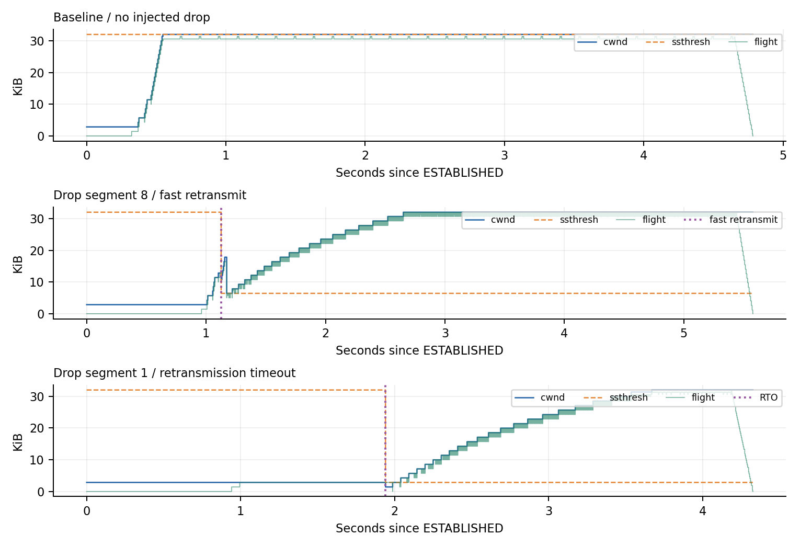

Lab 2 做完后，我们的栈已经能转发 IPv4 数据报了。Lab 3 接着在它上面实现简化的 TCP 和阻塞式 socket 接口，最后让原样的 echo 和 perf 跑过四个节点。这篇先看课程给出的抓包，再顺着 C 代码追一遍从 socket 调用到真正发包的过程。

## Writing Task 5

> Open trace.pcap with Wireshark. Answer the following questions.
>
> 1. How many TCP sessions are included in trace.pcap? How many segments are included in each session? (Hint: "Statistics" button in the menu bar may help you)
>
>     **Answer:** There are **2 TCP sessions**. In Wireshark's **Statistics → Conversations → TCP** view, their segment counts are:
>
>     | TCP Stream ID | A → B segments | B → A segments | Total segments |
>     | ------------- | -------------: | -------------: | -------------: |
>     | 0             |              6 |              6 |         **12** |
>     | 1             |            804 |            848 |       **1652** |
>
>     Here, endpoint A is `10.0.0.74`, and endpoint B is `115.27.207.221`. Both directions belong to the same session. The counts include all captured TCP segments, including connection-control segments, pure ACKs, and data-carrying segments. The total across both sessions is **1664 segments**.
>
> 2. We use a four-element tuple ⟨srcIP, srcport, dstIP, dstport⟩ to identify a TCP connection. Please list the tuples of each TCP connection in trace.pcap.
>
>     **Answer:** Using the direction from `10.0.0.74` to `115.27.207.221`, the connection tuples are:
>
>     - Stream 0: **⟨10.0.0.74, 43120, 115.27.207.221, 80⟩**.
>     - Stream 1: **⟨10.0.0.74, 43122, 115.27.207.221, 80⟩**.
>
>     The two connections use the same IP address pair and destination port, but different source ports. Reverse-direction packets exchange the source and destination endpoints while remaining part of the corresponding connection.
>
> 3. What is the TCP receive window size in packet No. 86? How is this value calculated?
>
>     **Answer:** The TCP receive window advertised in packet No. 86 is **43520 bytes**.
>
>     
>
>     Filtering with `frame.number == 86` shows a PSH/ACK segment from `115.27.207.221:80` to `10.0.0.74:43122`. Its raw 16-bit Window field is **85** (`0x0055`), and Wireshark reports a window scaling factor of **512**.
>
>     The scaling factor comes from the server's Window Scale option in the handshake. Filtering with `tcp.stream == 1 && tcp.flags.syn == 1` shows that packet No. **72**, the server's SYN/ACK, carries a Window Scale option with Kind = 3, Length = 3, and Shift count = **9**. Thus, the multiplier is `2^9 = 512`, and:
>
>     ```text
>     Receive window = Window field × 2^(shift count)
>                    = 85 × 2^9
>                    = 85 × 512
>                    = 43520 bytes
>     ```
>
>     Since packet No. 86 is sent by the server, this is the **server's advertised receive window**, which constrains data sent from the client to the server.
>
>     Window scaling applies to subsequent non-SYN segments. The Window field in a SYN or SYN/ACK is not scaled; accordingly, packet No. 72 has both a raw and calculated window of **43440 bytes**. This behavior follows [RFC 7323, Sections 2.2–2.3](https://www.rfc-editor.org/rfc/rfc7323.html#section-2.2).

## Programming Task 4

Lab 2 的 `sendIPPacket()` 接收一个数据报，就可以把它送到下一跳。到了 Lab 3，原样的 echo 和 perf 只知道 `socket()`、`connect()`、`read()` 和 `write()`。我们要做的是把这些调用接到同一进程里的用户态协议栈，再让两端通过之前实现的 IPv4 路径通信。

开始时我以为工作量主要在把 TCP 状态图翻译成 C。写到 `accept()` 和 `close()` 才发现，状态图旁边还要回答几个问题。谁有权改序号？收包回调返回之后，谁还持有那段字节？应用关掉 fd 了，谁继续发 FIN？下面按实现过程梳理，代码摘自归档的 `ac70880` 版，省略与当前片段无关的分支。报文字段和状态的定义可以对照 [RFC 793](https://www.rfc-editor.org/info/rfc793/) 和 [RFC 9293](https://www.rfc-editor.org/rfc/rfc9293.html)。

### 从 Lab 2 的 `main.c` 拆起

原来的初始化、收包和周期路由通告都放在路由器的 `main.c` 里。我们把它们移到 `stack_runtime.c`，让路由器和 socket 包装层都能启动这套运行环境。每个接口有自己的接收线程，维护线程继续处理路由和重组超时。TCP 再用一个协议线程管理监听器、连接表和定时器。

```text
应用线程：socket / bind / connect / accept / read / write / close
                         │ 控制请求、共享字节缓冲
                         ▼
协议线程：socket_control → tcp → ip_output → ip → packetio
                            ▲
                            │ 复制后的 TCP 段
接收线程：packetio → stack_runtime → ip / ip_reassembly → socket_transport
```

实际的收包入口是 `stack_runtime.c` 的 `dispatchFrame()`。IPv4 层负责校验和本机交付，经分片的本机数据报先在 `ip_reassembly.c` 拼齐。重组表以源 IP、目的 IP、协议号和 Identification 区分数据报。转发遇到更小的出口 MTU 时可以再分片，新的 offset 仍相对于最初的 IP 载荷。这条路径在 CL2 单独验证过，TCP 收包可以直接接在完整数据报的回调上。

`socket.c` 的 IP 回调把协议号 6 交给 `socketTransportReceiveIP()`。这一步按 IPv4 首部长度定位 TCP 段，把源、目的地址和段字节复制进有界队列。libpcap 和重组模块给出的输入都只在回调期间有效。若把原指针入队，工作线程读到它时，接收线程可能已经复用了缓冲。队列满时在接收端计数并丢包，发送端靠 TCP 恢复。

### `socket.c` 和 `socket_control.c`：原样应用怎样调用自己的栈

GNU ld 的 `--wrap` 在链接时把对 `socket` 等符号的引用指向对应的 `__wrap_*`。包装层用 `eventfd` 占一个真实的描述符编号，再登记到自己的 fd 表。第一次创建受支持的 socket 时初始化运行环境。Lab 3 的 `getaddrinfo` 则在 `socket_addr.c` 中处理实验使用的数字 IPv4 地址和端口。

`streamIO()` 开头的查表和回退，让同一份应用可以照常读文件、往终端写日志。

```c
SocketObject *o = socketObjectAcquire(fd);
if (!o) return writing ? __real_write(fd, buffer, size) : __real_read(fd, buffer, size);
```

查表成功会拿到对象引用。整数 fd 可以马上重用，这份引用仍指向旧对象，旧请求与新 fd 上的对象因此不会串起来。`bind()` 把复制后的地址提交给协议线程，由它维护端口表。通配地址会与同端口的具体地址冲突，端口 0 在临时范围里分配。后面加上监听与子连接之后，子连接继承监听器的端口，并按自己的四元组登记。

协议循环的顺序也有讲究，`socket_control.c` 每轮都先做下面这几步，再处理控制请求或等待最近的期限。

```c
tcpDrainCompletions(); /* Publish injection boundaries before processing ACKs. */
bool more = socketTransportPoll();
more = ipOutputPoll() || more;
more = tcpPoll() || more;
```

先处理注入完成，因为对端 ACK 可能已经由接收线程入队。若本地还没更新发送边界，就可能把这个 ACK 当作确认了尚未发送的数据。队列锁只保护入队、出队和等待条件。解码、状态转换和发包都在锁外做，`connect()` 或 `accept()` 让应用线程等待，协议线程继续工作。

### `tcp_packet.c` 和 `ip_output.c`：报文真的发出去了吗？

TCP 编解码器先做成了一个独立模块。首部字段按字节读写，C 结构体只表达主机序字段。解码先检查 Data Offset 是否落在段内，再校验 IPv4 伪首部、TCP 首部和载荷。奇数长度的最后一个字节在计算时视作一个 16 位字的高字节。EOL、NOP 和 MSS 按各自的格式处理，未知选项按长度跳过。解码得到的载荷视图借用事件缓冲。

下面是 CP7 在四节点末端实际抓到的 SYN，其中 TCP 从以太网帧偏移 34 开始。

```text
c0 00 27 66  51 ba bb 15  00 00 00 00  60 02 80 00
0b 79 00 00  02 04 05 b4
```

`c0 00` 和 `27 66` 分别是端口 49152、10086，`51 ba bb 15` 是初始序号。`60` 的高四位是 6，表示首部有 24 字节，`02` 表示 SYN。窗口 `0x8000` 为 32768，`02 04 05 b4` 是长度 4、值为 1460 的 MSS 选项。原帧还带两字节以太网填充，按 IPv4 Total Length 切出来的 TCP 段里没有这两个字节。

真正接上发送以后，我们遇到了一个 Lab 2 留下的问题。`sendIPPacket()` 在缺少 MAC 时会发 ARP 再睡一秒，最多等约八秒。TCP 用同一个线程为所有连接计时，如果在这里睡眠，一个地址解析失败也会拖住其他连接。

于是 `ipTrySendOnce()` 把结果分成三类。

| 结果 | 调用方如何推进 |
| --- | --- |
| `IP_SEND_SENT` | 全部帧已注入，TCP 可以记发送边界和时间 |
| `IP_SEND_NEIGHBOR_PENDING` | 尚未注入，保留请求并等待邻居解析 |
| `IP_SEND_ERROR` | 根据错误和 `emission_started` 处理，部分分片可能已经发出 |

最初异步解析跟着 socket 发送队列做。后来转发路径也需要解析下一跳，等待逻辑才抽到 `ip_output.c`，让本机发送与转发共用。路由区分已知 MAC、直连目的与指定网关。ARP 缓存按接口和 IP 查，解析任务合并同一邻居的探测。重试会重新查路由，TCP 源 IP 保持四元组里已经选定的值。ARP 等待期间，SYN 的重传计时还没开始。

这里还踩到了 libpcap 的批量交付。抓包已经看到 ARP 回复上了线，用户态却可能近一秒后才收到，因为旧 RX 用了 1000 ms 的 capture timeout。把 RX 句柄改成激活前设置 immediate mode 后，独立的两节点事件实验里，健康目标在另一个目标等待 ARP 时仍能完成发送。普通和 ASan 版测得的本地注入完成耗时分别是 0 ms、1 ms，使用毫秒计时。这个数值对应当时的两次运行。 [libpcap immediate mode](https://www.tcpdump.org/manpages/pcap_set_immediate_mode.3pcap.html)

### `tcp.c`：握手和 `accept()`

这里有三种对象。应用持有 `SocketObject`，监听器负责把新连接接进来，每条具体连接由一个 TCB 保存四元组、状态、发送和接收序号、窗口及计时器。普通的主动打开和被动打开按下面的顺序走，`x`、`y` 是两端的初始序号。

| 线上报文 | 主动方 | 被动方 |
| --- | --- | --- |
| `SYN(seq=x)` | 登记 TCB 并进入 `SYN_SENT` | 根据目的地址和端口找到监听器，建立 `SYN_RECEIVED` 子连接 |
| `SYN+ACK(seq=y, ack=x+1)` | 验证 ACK，记住对端序号，安排发送最终 ACK | 继续等待最终 ACK |
| `ACK(seq=x+1, ack=y+1)` | 最终 ACK 注入完成后向应用发布连接成功 | 验证 SEQ/ACK 后，子连接可以被 `accept()` 取走 |

`__wrap_connect()` 先提交命令，然后在 socket 对象上等 `connect_done`。命令已处理只说明 TCB 创建等本地操作完成。第三个包如果在路上丢了，服务端会重传 SYN/ACK；主动端收到同一握手的 SYN/ACK 会重新安排 ACK。SYN 消耗一个序号，纯 ACK 不消耗序号。32 位序号回绕则统一通过 `before()` 比较。

另一个坑出现在 `accept()`。如果工作线程直接把已握手连接从队列删除，应用线程接下来申请 `eventfd` 却遇到 `EMFILE`，那条连接就没人接了。因此代码里专门有三条命令。

1. `SOCKET_CMD_ACCEPT_RESERVE` 先保留子连接，返回 token。
2. 应用线程创建 socket 对象和描述符，成功后 `SOCKET_CMD_ACCEPT_COMMIT`，由协议线程关联子 TCB。
3. 中途失败时 `SOCKET_CMD_ACCEPT_CANCEL`，解除仍有效的保留。

这样，描述符发布失败和监听器关闭都能沿对象生命周期处理。监听 fd 始终可以继续接其他连接。

### `stream.c` 和 `tcp.c`：`write()` 返回之后

`StreamBuffer` 有独立的 TX 和 RX 环形缓冲。归档版本的默认 TX 是 256 KiB，RX 是 32 KiB。这个区别有实际用处。原样 perf 每轮先写完 146000 字节再读回显，服务端也会写回。如果两个方向都在等待写空间，而读还没开始，缩小 TX 容量足以让这条交互卡住。

`write()` 把字节拷进 TX 环并唤醒工作线程，能接纳多少就返回多少。待发、在途和已确认的位置通过序号和环形下标关联。旧的字节什么时候可以覆盖？在 `tcp.c` 处理累计 ACK 时，代码才推进环头并唤醒写者。

```c
assert(data_amount <= b->tx_size);
b->tx_head = (b->tx_head + data_amount) % STREAM_TX_CAPACITY;
b->tx_size -= data_amount;
pthread_cond_broadcast(&b->writable);
```

举个例子，假设最早未确认的位置是 1000，已经发送到 2000，而对端回 ACK 1460。发送环可以丢掉前 460 个字节，其余在途字节还得留着，以便按原序号重发。`write()` 返回只代表字节进入本地缓冲，首次发送边界按 IP 注入结果推进，累计 ACK 到达后才能归还发送缓冲空间。

接收方向用 `present[]` 表示各槽位是否已经收到。较高序号的数据先填进对应槽位，`RCV.NXT` 只跨过连续前缀。应用的 `read()` 只取 `rx_ready` 那段连续数据。读完会设置 `window_dirty` 并唤醒协议线程重新通告窗口。窗口从零恢复时若更新包恰好丢了，发送方的 persist 探测还能让接收端回报当前窗口。

新数据除了受 MSS 限制，还要同时通过接收窗口和拥塞窗口两道检查。下面这段在 `tcp.c` 的 `submitData()` 中，`flight` 是已发送但未被确认的序列空间。

```c
if (!t->resend) {
  uint32_t credit = before(seq, t->snd_edge) ? t->snd_edge - seq : 0;
  if (n > credit)
    n = credit;
  credit = t->cwnd > flight ? t->cwnd - flight : 0;
  if (n > credit)
    n = credit;
}
```

发送窗口右边界来自对端的 ACK 和 Window，`cwnd` 则根据本地记录的 ACK 与丢包情况变化。实现里有慢启动、拥塞避免、快重传/快恢复和超时退避。WT5 用的课程抓包协商了 Window Scale，这个栈的实验连接使用未缩放的窗口。

### FIN、半关闭和进程退出

`close()` 释放应用 fd 时，TCB 可能仍然握有发送缓冲和未确认字节。实现先确定 FIN 的序号，等排在它前面的字节送出，再把 FIN 放到线上。FIN 和 SYN 一样消耗一个序号，也可能需要重传。对端先到达的 FIN 若前面还有缺口，要等缺口补齐才发布 EOF；应用还有连续数据可读时，`read()` 先交出数据，之后才返回 0。

`shutdown(SHUT_WR)` 表达的正是只结束发送方向。普通主动关闭则可能经过 `FIN_WAIT_1`、`FIN_WAIT_2` 和 `TIME_WAIT`。CL1 还测试了双方同时连接和同时关闭，协议记录里实际走到了 `SYN_RECEIVED` 和 `CLOSING`。TIME-WAIT 内仍保留连接状态，以便再次确认对端重传的 FIN。

最后一个问题出在原样应用的退出。只测 `close()` 还不够，因为应用可能直接从 `main` 返回，或者调用 `exit()`。所以原样应用目标还链接了 `app_lifecycle.c`，在正常退出路径调用 `socketLayerDrain()`，给已接纳数据和连接关闭留出受限的排空时间。若断链后超过期限，日志报告失败连接数和丢弃字节数，退出码也反映失败。停止时先让协议线程结束网络活动，再由运行模块回收设备句柄。

## Checkpoints 和实际验证

把握手、字节流和关闭分别测过之后，我们用原样 echo/perf 跑了 Lab 2 已经用过的四节点拓扑。

```text
ns1（应用 + 用户态 TCP） ─ ns2（IPv4 转发） ─ ns3（IPv4 转发） ─ ns4（应用 + 用户态 TCP）
```

CP8 的一组受控实验让对端忽略前两个 SYN。初始测试 RTO 设为 100 ms，抓到同一序号的 SYN 在约 100 ms、300 ms 再次出现，随后完成握手。另一组 perf 抓包里，乱序段已经到达，累计 ACK 却一直停在缺口起点 `1549651643`。缺失的 1460 字节补齐后，ACK 一次推进到 `1549663140`，前面缓存的乱序段也变成了连续字节。两端的 ingress 抓包能确认缺口被填上，受控丢包实验则另外校验了重传。

CP9/CP10 覆盖 echo/perf × 正常/损伤链路 × 普通/ASan 共八组。复核脚本检查了 14,217 个 TCP 包、双向合计 12,040,000 字节交付载荷以及 32 个处于正确流末尾且得到确认的 FIN。六个原样应用 C/H 文件和旧版本逐字节一致，应用通过链接选项进入我们的栈。

做 CL5 时，单看 Wireshark 推不出发送端每时刻的 `cwnd`。我们在 `tcp_trace.c` 加了一个有界记录缓冲，由协议线程写入窗口、在途字节、RTO 和重传事件，停止后再导出。评测把同一份 POSIX 程序分别链接到内核 socket 和用户态栈。下图来自用户态栈的记录。桥接出口丢第 8 个数据段时触发快重传，丢首段时触发 RTO，因此可以把窗口下降对回具体事件。



## 易踩的坑

1. **把排队当成已经发包。** 等 ARP 的 SYN 还没上路。在处理 ACK 前先消费注入完成事件，才能使用正确的发送边界。

2. **把 fd 当连接身份。** fd 可以重用。已排队的操作靠对象引用或 TCB 身份查找原来的连接。

3. **收到乱序段就推进累计 ACK。** 接收环可以先保存高序号数据，ACK 只能指到连续前缀的末尾。

4. **收到 FIN 就立刻让应用读到 EOF。** 前面的字节可能还在路上，也可能已经在接收缓冲里。FIN 可按序处理且应用读完连续数据后，`read()` 才返回 0。

   
